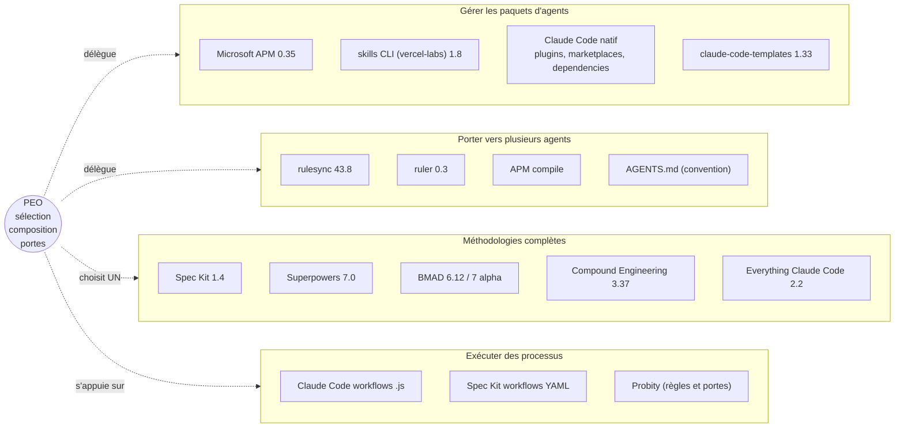

# 02 — Analyse concurrentielle et écosystème

> Vérifié le 2026-11-11 par clone des dépôts (commit et date indiqués) et lecture de la doc officielle.
> Les nombres d'étoiles n'ont pas pu être relevés (API GitHub indisponible dans cet environnement). Ils ne sont pas utilisés comme critère.

## 1. Cartographie

PEO touche quatre fonctions. Pour chacune, des outils existent déjà.

## 2. Concurrents directs

### 2.1 Microsoft APM — Agent Package Manager

[FAIT] `microsoft/apm`, version `0.35.0`, Apache-2.0, commit `cd927db` du 2026-11-11.

- Manifeste `apm.yml` par projet : instructions, skills, prompts, agents, hooks, plugins, serveurs MCP.
- `apm install` reproduit la configuration pour **9 agents** (Copilot, Claude, Grok Build, Cursor, OpenCode, Codex, Gemini, Windsurf, Kiro).
- Lockfile `apm.lock.yaml` avec **empreintes de contenu**, export SBOM (CycloneDX, SPDX).
- Dépendances transitives, sources Git de tout hébergeur (dont GitLab).
- `apm uninstall` ne supprime **que les fichiers listés dans `deployed_files` du lockfile** : les contenus écrits à la main sont préservés.
- `apm update` affiche un plan (ajouté, mis à jour, supprimé, inchangé) et demande un accord, refus par défaut. `--yes` exigé hors interactif.
- `apm audit` : reconstruit le contexte dans un dossier temporaire et le compare à l'arbre de travail (dérive). Recherche de caractères Unicode cachés à chaque installation.
- `apm-policy.yml` : politique de sources et de primitives autorisées, héritage entreprise → organisation → dépôt.
- **Pour Claude Code**, APM **copie les primitives** dans `.claude/rules/`, `.claude/agents/`, `.claude/commands/`, `.claude/skills/` et fusionne les hooks dans `.claude/settings.json`. Il ne passe pas par le système de plugins natif de Claude Code (la doc indique `enabledPlugins` géré seulement pour Copilot).

Source : README et `docs/src/content/docs/reference/` du dépôt (`cli/uninstall.md`, `cli/update.md`, `targets-matrix.md`).

**Recouvrement avec PEO** : Plugin Manager, verrouillage, désinstallation propre, audit, politique, portabilité. **C'est le concurrent le plus sérieux** pour toute la partie « gestion du cycle de vie ».

**Ce qu'APM ne fait pas** : choisir les outils, détecter les conflits fonctionnels entre méthodologies, connaître le coût en contexte, imposer des portes de processus.

### 2.2 Everything Claude Code (ECC)

[FAIT] `affaan-m/everything-claude-code`, plugin `ecc` `2.2.3`, MIT, commit `d2ef268` du 2026-11-06.

- Se présente comme « agent harness operating system » : **71 agents, 314 skills** (dont 313 invocables par le modèle), commandes, règles, conventions MCP.
- `hooks/hooks.json` : **27 gestionnaires sur 8 événements** (`PreToolUse` 10, `Stop` 8, `SessionStart` 2…), réglables par `userConfig` (`hooks_enabled`, `hook_profile` minimal / standard / strict).
- **Profils d'installation** (`manifests/install-profiles.json`) : `minimal`, `core`, `developer`, `security`, `research`… composés de **modules** (`install-modules.json`). Assistant d'installation qui inventorie les portées Claude existantes.
- **Manifeste de propriété** pour la synchronisation Codex : à la désinstallation, ECC ne supprime que ce qu'il peut prouver avoir écrit.
- Offre commerciale associée (ECC Pro, GitHub App).

**Recouvrement avec PEO** : sélection par profils, installation multi-cibles, idée d'un environnement complet.

**Différence** : ECC est un **écosystème unique** très large que l'on découpe en profils statiques. PEO doit **choisir entre écosystèmes** à partir du projet. ECC serait, dans le catalogue de PEO, un candidat « socle complet », avec un coût de contexte très élevé.

**Concepts à reprendre** [RECO] : modules et profils déclaratifs, manifeste de propriété des fichiers, niveaux de hooks.

### 2.3 claude-code-templates (aitmpl)

[FAIT] `davila7/claude-code-templates`, version `1.33.1`, MIT, commit `07607d9` du 2026-11-10.

- CLI `npx claude-code-templates` qui installe des composants unitaires : `--agent`, `--command`, `--mcp`, `--setting`, `--hook`, et des combinaisons « stack » en une commande.
- `--health-check` : diagnostic de l'installation Claude Code et du projet. `--analytics` : suivi des sessions.

**Recouvrement** : catalogue de composants, installation, diagnostic. **Différence** : catalogue large non évalué, pas de sélection à partir du projet, pas de lockfile.

### 2.4 skills CLI (vercel-labs/skills)

[FAIT] `vercel-labs/skills`, version `1.8.1`, MIT, commit `e781cb4` du 2026-11-10.

- `npx skills find | add | list | check | update | remove`.
- `skills-lock.json` (version 2) avec **empreinte du contenu** de chaque skill installé.
- Installe dans `.agents/skills/` et dans les dossiers propres à chaque agent.

**Recouvrement** : cycle de vie des skills copiés. **Utilisation par PEO** [RECO] : installeur délégué pour les skills copiés (« vendored »), plutôt qu'un mécanisme maison.

## 3. Outils complémentaires (à réutiliser, pas à concurrencer)

| Outil | Version, date | Fonction | Rôle pour PEO |
|---|---|---|---|
| **rulesync** | `43.8.0`, MIT, 2026-11-09 | Génère les fichiers de config de nombreux agents (règles, MCP, commandes, sous-agents, skills, hooks, permissions) à partir de `.rulesync/`. Import depuis `CLAUDE.md`, `.cursorrules`… | Délégué possible pour la **portabilité** (P10) |
| **ruler** | `0.3.46`, MIT, 2026-10-28 | Même idée, plus simple : une source de règles distribuée vers les agents | Alternative à rulesync |
| **AGENTS.md** | convention | Fichier d'instructions lu par de nombreux agents. Claude Code le lit seulement s'il n'y a pas de `CLAUDE.md` | **Format pivot** de PEO dès le MVP |
| **Probity** | MIT, 2026-11-03 | Successeur de TDD Guard : règles **déterministes ou validées par IA** sur chaque écriture et commande, pour Claude Code, Codex et Copilot CLI. Config en TypeScript | Candidat **moteur de portes** (document 03) |
| **Spec Kit** | `1.4.0`, MIT | Catalogues d'extensions, bundles, presets, workflows YAML, 43 intégrations | Socle méthodologique candidat, et modèle d'architecture « primitives composables » |

## 4. Fonctions déjà couvertes par Claude Code

[FAIT] Vérifié dans la documentation officielle le 2026-11-11.

| Fonction | Mécanisme natif | Conséquence pour PEO |
|---|---|---|
| Initialiser des instructions | `/init` | Ne pas refaire. PEO produit `AGENTS.md` et pointe |
| Installer, activer, désactiver, mettre à jour un plugin | `claude plugin install | enable | disable | update | uninstall`, `--scope user|project|local` | **Déléguer** |
| Regrouper des plugins | `dependencies` dans `plugin.json`, contraintes semver sur tags `<plugin>--v<version>`, auto-installation | Utiliser pour le plugin PEO lui-même si besoin, pas pour la sélection (portée unique) |
| Marketplaces d'équipe | `extraKnownMarketplaces`, `enabledPlugins` dans `.claude/settings.json` | **Déléguer** : c'est la sortie de PEO |
| Politique d'organisation | Paramètres gérés (`strictKnownMarketplaces`, plugins imposés) | Ne pas refaire |
| Préférences par plugin | `userConfig` (stocké dans `pluginConfigs`, valeurs sensibles dans le trousseau) | Utiliser pour les préférences personnelles de PEO |
| Exécuter un processus multi-agents | Workflows dynamiques `.js` : `agent()`, `pipeline()`, `parallel()`, reprise. **Pas de saisie utilisateur en cours de run** | Bon pour la **découverte profonde** et les audits. Inadapté au processus avec validations humaines |
| Règles conditionnelles | `.claude/rules/*.md` avec `paths:` | Sortie de PEO pour les règles par stack |
| Mémoire | `CLAUDE.md`, imports `@`, auto memory hors dépôt | PEO désactive l'auto memory par projet (choix) et versionne |

## 5. Méthodologies complètes (candidates « socle » dans le catalogue)

Ces outils ne sont pas des concurrents de PEO : ce sont des **options entre lesquelles PEO choisit**. Leur point commun, vérifié : chacun couvre presque tout le cycle, de l'idée au code. **Deux d'entre eux ne doivent jamais être actifs ensemble.**

| Socle | Points forts | Coût et risques | Fiche |
|---|---|---|---|
| **Spec Kit + EGM + Matt Pocock** (composé) | Artefacts traçables, relecture indépendante, TDD par tranches | Trois outils à épingler, intégration à maintenir | Document 03 |
| **Superpowers** | Méthodologie cohérente en 14 skills | Hook `SessionStart` qui impose ses skills à chaque session | Document 03 |
| **BMAD Method** | Agile complet, du brief à l'architecture. v6.12 stable via `npx bmad-method install`, v7 en alpha via skills CLI ou plugin | v7 instable (« Expect breaking changes ») | [HYPOTHÈSE] non audité en profondeur ici |
| **Compound Engineering** | Boucle plan → travail → revue → capitalisation | 28 skills invocables par le modèle | Document 03 |
| **Everything Claude Code** | Tout-en-un, profils | Très gros contexte, 27 hooks | Document 03 |

## 6. Concepts à reprendre

| Concept | Origine | Usage dans PEO |
|---|---|---|
| Manifeste + lockfile à empreintes | APM, skills CLI | `.peo/peo.lock.json` avec version **et** empreinte quand l'installeur le permet |
| Désinstallation limitée aux fichiers possédés | APM (`deployed_files`), ECC (manifeste de propriété) | Champ `owns` dans chaque fiche et dans le lock |
| Plan affiché puis accord, refus par défaut | APM `update` | Toute action de PEO passe par un plan |
| Audit par reconstruction et comparaison | APM `audit` | `peo status --drift` |
| Recherche d'Unicode caché | APM | Contrôle à l'ajout d'un skill copié |
| Profils composés de modules | ECC | Les **capacités** jouent ce rôle, de façon calculée |
| Primitives composables (extension, preset, bundle) | Spec Kit | Structure du catalogue |
| CLI + skills plutôt que MCP pour les agents de code | README de Playwright MCP | Règle de sélection : préférer CLI + skill quand les deux existent |

## 7. Positionnement

| | APM | ECC | claude-code-templates | **PEO** |
|---|---|---|---|---|
| Choisit les outils pour le projet | Non | Profils statiques | Non | **Oui, justifié** |
| Connaît les conflits entre outils | Non | Interne à ECC | Non | **Oui** |
| Coût en contexte connu | Non | Non | Non | **Oui** |
| Installe | Oui (copie) | Oui | Oui (copie) | **Délègue** |
| Lockfile | Oui, empreintes | État d'installation | Non | Oui (versions + empreintes déléguées) |
| Multi-agents | 9 agents | Plusieurs | Claude | Claude d'abord, données portables |
| Processus avec portes | Non | Hooks, pas de portes de processus | Non | **Oui** |
| Neutre entre méthodologies | Oui (pas de méthodologie) | Non | Oui | **Oui, par construction** |

**Position recommandée** [RECO] : PEO est le **conseiller et le chef d'orchestre**, APM et les installeurs natifs sont les **déménageurs**, les méthodologies sont les **musiciens**.

## 8. Décision à prendre

[DÉCISION] **Backend d'installation des primitives non-plugin** :

| Option | Avantages | Inconvénients |
|---|---|---|
| A. Installeurs natifs par type (Claude plugin CLI, `claude mcp`, `uv`, skills CLI) | Comportement natif, mises à jour natives des plugins, pas de dépendance nouvelle | Un adaptateur par type à écrire |
| B. Déléguer à APM | Lockfile à empreintes, désinstallation propre, 9 agents | APM copie au lieu d'activer les plugins natifs. Projet en `0.x`. Dépendance forte à un outil tiers |
| C. A pour le MVP, interface d'adaptateur permettant B ensuite | Démarrage simple, porte ouverte | Abstraction à concevoir dès le départ |

Ma recommandation : **C**.

## 9. Mise à jour du 2026-11-12

Détail, méthode et matrice des capacités : document 18. Sécurité et confidentialité : document 17.

### 9.1 Orchestrateurs : une couche d'exécution, pas un concurrent direct

Orka, Hivemind, set-core, Citadel, OpenRig, Cezar, Kansei et CCPM lancent, parallélisent et fusionnent le travail des agents (worktrees, revues séparées, portes, budgets). PEO ne va pas sur ce terrain. Ce sont des **entrées de catalogue potentielles** qui posent des hooks, des réglages et parfois un agent par défaut : l'Inventory doit les voir, et le Selector refuser d'en cumuler deux (capacité exclusive `orchestration.harness`, ajoutée avec la première fiche, H25).

| Concept | Origine | Usage dans PEO |
|---|---|---|
| L'auteur ne revoit jamais son propre travail ; revue sécurité comme porte distincte | Orka | Recette (étape de revue sécurité sans contexte, principe Goldfish d'EGM) |
| Configuration du dépôt dans un petit fichier, règles dans `CLAUDE.md`/`AGENTS.md` | Orka | Déjà le cas (`peo.toml` + `AGENTS.md`) |
| Installation épinglée sur un tag, en portée locale ; résultats négatifs publiés | Citadel | Règle de fiche ; ton du rapport `peo status` |
| Porte anti-fuite au commit et avant les outils | set-core (`set-leakscan`) | Délégué à Gitleaks et à Cloakroom |

### 9.2 Confidentialité : des outils spécialisés existent

Cloakroom (pseudonymisation réversible, multi-agents), Agent Privacy (redaction, expérimental), BlackBar (captures Chrome), Presidio (SDK de PII), Gitleaks (secrets). PEO les **détecte, les recommande et vérifie leur présence** ; il ne refait aucun de leurs mécanismes (H21).

### 9.3 Changements d'adresse

ECC → `affaan-m/ECC` ; Presidio → `data-privacy-stack/presidio`. `openrig/openrig` n'existe pas (projet : `mvschwarz/openrig`) ; `Kaportaci31/openrig` est un leurre probable.

### 9.4 Positionnement (complément de la section 7)

| | APM | ECC | Orchestrateurs | Cloakroom | **PEO** |
|---|---|---|---|---|---|
| Inventaire des hooks par événement et propriétaire | Non | Non | Non | Partiel (`cloakroom scan`) | **Oui** |
| Audit des surfaces exposées à l'agent | Non | Non | Non | Partiel (`cloakroom exposure`) | **Oui** |
| Sur le chemin des données | Non | Hooks | Non | **Oui** | **Non, par construction** |

## Sources

- [microsoft/apm](https://github.com/microsoft/apm) · [affaan-m/everything-claude-code](https://github.com/affaan-m/everything-claude-code) · [davila7/claude-code-templates](https://github.com/davila7/claude-code-templates) · [docs aitmpl](https://docs.aitmpl.com/cli/overview)
- [vercel-labs/skills](https://github.com/vercel-labs/skills) · [dyoshikawa/rulesync](https://github.com/dyoshikawa/rulesync) · [intellectronica/ruler](https://github.com/intellectronica/ruler)
- [bmad-code-org/BMAD-METHOD](https://github.com/bmad-code-org/BMAD-METHOD) · [nizos/probity](https://github.com/nizos/probity) · [github/spec-kit](https://github.com/github/spec-kit)
- Claude Code : [workflows](https://code.claude.com/docs/en/workflows.md), [manifeste de plugin](https://code.claude.com/docs/en/plugins/manifest-reference.md), [dépendances](https://code.claude.com/docs/en/plugins/dependencies.md), [plugins d'organisation](https://code.claude.com/docs/en/plugins/org.md)
- [microsoft/playwright-mcp](https://github.com/microsoft/playwright-mcp) (recommandation CLI + skills)
- Mise à jour du 2026-11-12 : sources des documents 17 et 18
