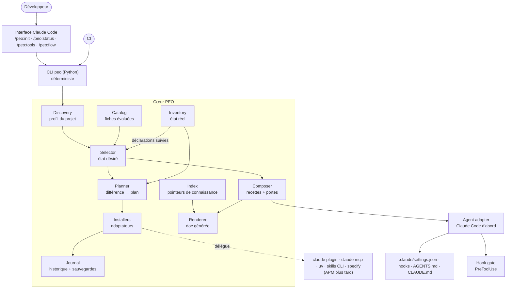
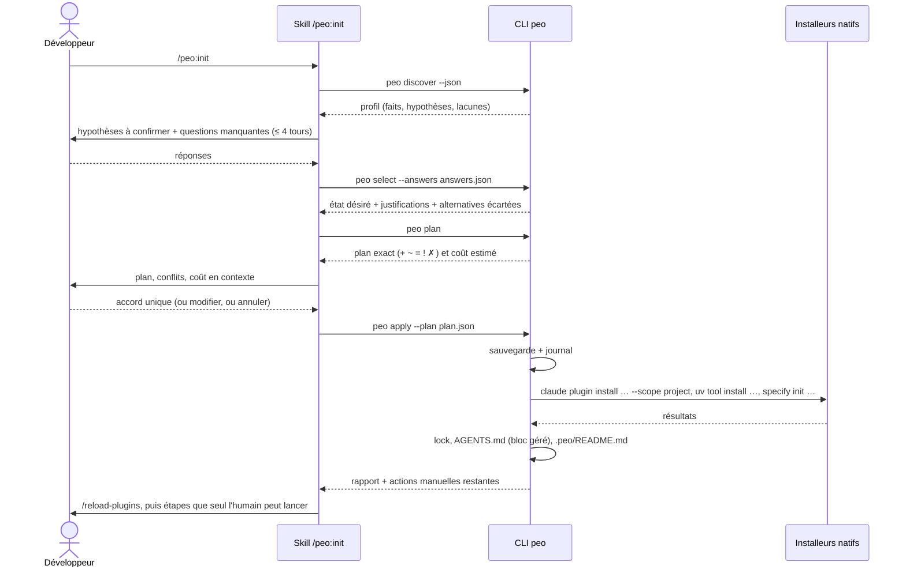
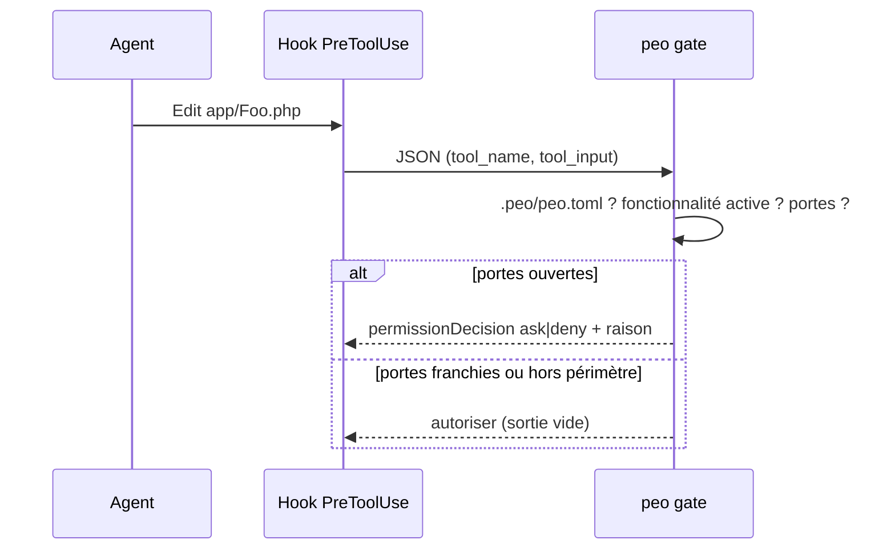

# 04 — Challenge architectural et architecture cible

> Tout ce document est **[RECO]** sauf mention **[FAIT]**.
>
> **Mise à jour du 2026-11-11** : la spécification détaillée ([spec/](spec/10-spec-overview.md)) précise ce document. Points qui le modifient : la porte et le hook de contexte sont écrits dans le `.claude/settings.json` **du projet** et non dans le plugin, parce que leur `matcher` dépend des outils retenus (décision S-2) ; un dépôt a des **composants** (E1) et la porte protège les chemins de code de tous ; l'agent ne peut pas s'approuver une porte (spec 15, section 4.1 bis).
>
> **Révision du 2026-11-12** (section 9) : aucun nouveau composant. La sécurité et la confidentialité deviennent des détecteurs de Discovery, des contrôles de l'Inventory et de `peo status`, et des capacités du catalogue (document 17).

## 1. Challenge des dix composants proposés

| Composant proposé | Verdict | Raison | Devient |
|---|---|---|---|
| PEO Core | Garder, réduire | Un « cœur » qui orchestre tout devient vite un fourre-tout | **CLI `peo`** : commandes, configuration, journal |
| Discovery Engine | **Garder** | Valeur centrale, et entièrement déterministe | **Discovery** |
| Plugin Registry | Garder, **renommer** | Ce n'est pas un registre de paquets (les marketplaces existent) mais une **base d'évaluations** | **Catalog** |
| Plugin Manager | **Réduire fortement** | Installer, mettre à jour, résoudre les versions : déjà fait par les installeurs natifs et APM | **Planner** (calcule) + **Installers** (adaptateurs qui délèguent) |
| Plugin Selection Engine | **Garder**, c'est le cœur de la valeur | Rien d'équivalent sur le marché | **Selector** |
| Dependency Resolver | **Supprimer** comme composant | Dépendances d'installation : résolues par chaque installeur. Dépendances fonctionnelles (« A requiert B ») : contraintes du Selector | Fondu dans **Selector** |
| Workflow Engine | **Remplacer** | Un moteur d'exécution recrée Spec Kit workflows ou Claude Code workflows. Le besoin réel est de **composer** une recette et d'**appliquer** des portes | **Composer** (recette) + **Gate** (hook) |
| Knowledge Manager | **Réduire** | Stocker la connaissance dans `.peo/` crée une seconde documentation. Les outils ont déjà leurs emplacements (ADR, glossaire, constitution) | **Index** de pointeurs + contrôles de dérive |
| Project Context Manager | **Supprimer** comme composant | C'est la lecture et l'écriture d'un fichier de configuration | Module de configuration du CLI |
| Claude Code Adapter | **Garder**, généraliser | Indispensable, et c'est le point d'extension pour d'autres agents | **Agent adapter** (Claude d'abord) |

### Responsabilités mal placées et dépendances circulaires

1. **Selection ↔ Manager** : la sélection a besoin de savoir ce qui est installé, et le gestionnaire a besoin de la sélection pour vérifier la compatibilité. Boucle. **Solution** : un composant **Inventory** en lecture seule, utilisé par les deux. Le Selector produit un état **désiré**, l'Inventory fournit l'état **réel**, le Planner calcule la différence. Plus de cycle.
2. **Knowledge ↔ Workflow** : le moteur de workflows écrirait de la connaissance, que le gestionnaire de connaissances voudrait réorganiser. **Solution** : ni l'un ni l'autre n'écrit de connaissance. Les outils du socle l'écrivent à leurs emplacements natifs. PEO ne fait qu'**indexer** et **vérifier**.
3. **Agents `.peo/agents/`** (architecte, développeur, reviewer, sécurité) : ce sont des personas qui recouvrent ceux des outils (Goldfish d'EGM, sous-agents de `code-review`). **Supprimés.** PEO ne définit pas d'agents (principe « ne pas confondre orchestration et accumulation d'agents »).

## 2. Architecture cible simplifiée (MVP)

### 2.1 Vue fonctionnelle



### 2.2 Composants du MVP

| Composant | Responsabilité unique | Entrées | Sorties | LLM ? |
|---|---|---|---|---|
| **Discovery** | Construire le profil du projet | Dépôt, poste | `profile.json` (faits + hypothèses avec niveau de confiance) | Non |
| **Catalog** | Charger et valider les fiches d'outils | Dépôt du catalogue (versionné) + surcharges locales | Fiches validées | Non |
| **Inventory** | Lire l'état réel | Réglages Claude des portées managed, local, project et user, `.mcp.json`, `claude plugin list` | État installé, activé, versions, hooks actifs | Non |
| **Selector** | Calculer l'ensemble minimal d'outils | Profil + réponses + catalogue + déclarations suivies du projet (H27) | État désiré, justifications, alternatives écartées | Non (règles + optimisation) |
| **Planner** | Différence désiré / réel → actions ordonnées | État désiré, état réel | Plan (`+ ~ = ! ✗`) | Non |
| **Installers** | Exécuter une action d'un type donné en déléguant | Une action du plan | Résultat, artefacts possédés | Non |
| **Composer** | Choisir la recette de processus et ses portes | Socle choisi, voie, profil | Recette, portes, configuration de hooks | Non |
| **Index** | Savoir où vit chaque type de connaissance | Socle choisi, chemins réels du dépôt | Table de pointeurs, contrôles (liens, tailles, fraîcheur) | Non |
| **Journal** | Tracer et sauvegarder | Toute écriture | `history.ndjson`, sauvegardes | Non |
| **Renderer** | Produire la doc du projet | Config, index, recette | `.peo/README.md`, `AGENTS.md` (bloc géré) | Non (gabarits). Le LLM ne rédige que la mission |
| **Agent adapter (Claude)** | Traduire la sortie pour Claude Code | Recette, plan | Settings, hooks, skills, `CLAUDE.md` | Non |
| **Interface (plugin Claude)** | Dialogue : questions, explications, présentation du plan | Sorties du CLI | Réponses de l'utilisateur | **Oui**, uniquement ici |

**Principe directeur** : **tout ce qui doit être exact est calculé par le CLI**. Le modèle pose les questions, reformule les justifications, rédige la mission. Il ne décide ni des outils, ni des fichiers, ni des versions.

### 2.3 Pourquoi un CLI Python plutôt que tout en skills

| Critère | Tout en skills et prompts | CLI Python + skills fins |
|---|---|---|
| Reproductibilité | Faible : deux runs donnent deux sélections | Totale : mêmes entrées, même plan |
| Testabilité | Évaluations coûteuses de LLM | Tests unitaires classiques |
| Coût en tokens | Le modèle lit le catalogue et le dépôt | Le modèle lit un JSON de synthèse |
| Utilisable en CI | Non | Oui (`peo status --ci`) |
| Portabilité vers d'autres agents | Réécrire les prompts | Le CLI ne change pas, seul l'adaptateur change |

**Python 3.11+, bibliothèque standard uniquement** pour le cœur (`tomllib`, `json`, `subprocess`, `pathlib`, `hashlib`). Spec Kit exige déjà Python 3.11+. [DÉCISION] Alternative : Go ou Rust pour un binaire unique, plus lourd à faire évoluer.

### 2.4 MCP : pas au MVP

[RECO] PEO **n'expose pas de serveur MCP** au MVP. Un MCP ajouterait des schémas d'outils au contexte permanent, pour des commandes qu'on lance quelques fois par projet. Le plugin appelle le CLI depuis ses skills, avec chemins substitués par `${CLAUDE_PLUGIN_ROOT}` [FAIT, manifeste de plugin]. À reconsidérer pour P10 si un agent sans skills doit piloter PEO.

## 3. Flux d'exécution

### 3.1 `/peo:init`



### 3.2 Écriture de code pendant une fonctionnalité



## 4. Structure `.peo/` : challenge et version définitive

### 4.1 Verdict sur la proposition initiale (30 éléments)

| Élément proposé | Verdict | Raison |
|---|---|---|
| `project.yaml`, `profile.yaml`, `capabilities.yaml`, `workflow.yaml`, `policies.yaml` | **Fusionner** en un fichier de configuration | Cinq fichiers pour une configuration qui tient en 100 lignes. Les références croisées deviennent fragiles |
| `profile.yaml` | Garder, **généré** | Sortie de Discovery, régénérable, utile pour les diffs |
| `state.yaml` | **Supprimer** | État de fonctionnalité : déjà dans les artefacts du socle (`specs/NNN/`). État d'installation : dans le lock |
| `plugins/registry.yaml` | **Supprimer** du projet | Le catalogue appartient à PEO, pas au projet. Le projet ne garde que ses **surcharges** éventuelles |
| `plugins/installed.yaml` | **Supprimer** | L'état réel se lit (Inventory). L'écrire crée une copie qui dérive |
| `plugins/lock.yaml` | Garder | Reproductibilité |
| `plugins/history.ndjson`, `history/changes.ndjson` | **Fusionner** | Deux journaux pour le même flux |
| `plugins/backups/` | Garder, **hors git** | Restauration locale |
| `context/*.md`, `architecture/*.md`, `knowledge/*` | **Supprimer** | Second système de documentation. Ces connaissances vivent dans `AGENTS.md`, `GLOSSARY.md`, `docs/adr/`, `docs/architecture/` et les artefacts du socle |
| `workflows/*.md` | **Supprimer** | Les recettes viennent du catalogue. Le projet ne garde que des **surcharges** dans la configuration |
| `agents/*.md` | **Supprimer** | Voir section 1 |
| `standards/` | **Supprimer** | Les standards vivent à leur emplacement natif (constitution, `CODING_STANDARDS.md`, règles par chemin) |
| `reports/` | **Supprimer** | Rapport d'initialisation = journal + doc générée. Rapports d'audit = sortie de commande, pas des fichiers à maintenir |

### 4.2 Structure définitive

```text
project/
├── .peo/
│   ├── peo.toml            # CONFIGURATION — source de vérité de PEO pour ce projet. Versionné, éditable
│   ├── profile.json        # GÉNÉRÉ par Discovery — faits et hypothèses. Versionné (diffs utiles), jamais édité
│   ├── peo.lock.json       # GÉNÉRÉ — versions, empreintes, artefacts possédés par chaque outil. Versionné
│   ├── history.ndjson      # JOURNAL — une ligne par action de PEO. Versionné, fusion « union »
│   ├── README.md           # GÉNÉRÉ — doc du workflow pour ce projet. Section « Notes » libre
│   └── backups/            # sauvegardes avant écriture — ignoré par git
├── AGENTS.md               # bloc géré par PEO entre marqueurs, le reste appartient au projet
├── CLAUDE.md               # « @AGENTS.md » + éléments propres à Claude
├── .claude/settings.json   # sortie de l'adaptateur Claude (plugins, hooks, permissions)
└── <emplacements natifs des outils choisis : specs/, docs/adr/, GLOSSARY.md, .specify/ …>
```

**Cinq fichiers, une seule source éditable** (`peo.toml`). Tout le reste est soit généré (donc reproductible), soit un journal.

### 4.3 Ce qui reste à son emplacement natif

| Connaissance | Emplacement | Propriétaire |
|---|---|---|
| Contexte et pointeurs | `AGENTS.md` | Projet (bloc géré par PEO) |
| Vocabulaire | `GLOSSARY.md` (ou équivalent du socle) | Socle |
| Décisions | `docs/adr/` | Socle, humain |
| Principes | constitution du socle ou `CODING_STANDARDS.md` | Socle, humain |
| Spécifications, plans, tâches | dossier du socle (`specs/` pour Spec Kit) | Socle |
| Architecture | `docs/architecture/` | Humain |
| Dette technique | issues du tracker, ou `docs/tech-debt.md` | Humain |
| Leçons | `docs/solutions/` si le socle le prévoit | Socle |

`peo.toml` contient seulement la **table de ces emplacements** (section `[knowledge]`), pour que PEO, les hooks et la CI sachent où regarder.

## 5. Format des données

| Format | Usage | Justification |
|---|---|---|
| **TOML** | Configuration éditée à la main (`peo.toml`), fiches du catalogue | Lu par la bibliothèque standard Python (`tomllib`). Types sans ambiguïté. Lisible |
| **JSON** | Fichiers générés (`profile.json`, `peo.lock.json`), échanges CLI ↔ skill | Standard, diffable, schéma JSON pour la validation |
| **NDJSON** | Journal | Ajout en fin de fichier, une ligne par événement. `.gitattributes` : `merge=union` pour éviter les conflits entre branches |
| **Markdown** | Doc générée, `AGENTS.md` | Lu par tous les agents |
| YAML | **Non** au MVP | Bibliothèque externe requise, typage implicite piégeux. [DÉCISION] si tu préfères YAML pour l'habitude (Kubernetes, CI), le coût est une dépendance `PyYAML` |
| SQLite | **Non** | Binaire, non diffable, inutile à cette échelle. Possible plus tard comme **cache** hors dépôt |

## 6. Commandes

### 6.1 Challenge de la liste proposée (18 commandes)

- Trois commandes de diagnostic (`audit`, `health`, `drift`) et `status` décrivent la même chose à des profondeurs différentes. → **une** commande avec options.
- Huit commandes `plugin-*` → **une** commande avec sous-commandes. Le mot « plugin » est trop étroit : PEO gère aussi des MCP, des CLI, des skills copiés → **`tools`**.
- `feature`, `bugfix`, `review`, `workflow` : ce sont des **recettes** d'une même commande → **`flow <recette>`**.
- `update` est ambigu (outils ? PEO lui-même ? configuration ?) → `tools update` et mise à jour de PEO par le gestionnaire de plugins natif.
- Les skills de plugin Claude sont préfixés par le nom du plugin [FAIT] : la forme naturelle est `/peo:init` et non `/peo-init`.

### 6.2 Nomenclature proposée

| Commande Claude | CLI équivalent | Rôle | MVP |
|---|---|---|---|
| `/peo:init` | `peo discover`, `peo select`, `peo plan`, `peo apply` | Initialiser ou reconfigurer | **Oui** |
| `/peo:status [--drift] [--hooks] [--ci]` | `peo status` | État, conflits, hooks actifs, dérive, versions | **Oui** |
| `/peo:tools [list|add|remove|enable|disable|update|audit] …` | `peo tools …` | Cycle de vie d'un outil | **Oui** : `list`, `add`, `remove`, `enable`, `disable`, `audit`. `update` en mode manuel |
| `/peo:flow [feature|bugfix|refactor|review|release] [close]` | `peo flow …` | Recette en cours, prochaine commande, portes | **Oui** : `feature`, `bugfix` |
| — | `peo gate`, `peo context` | Appelés par les hooks, pas par l'humain | **Oui** |
| — | `peo catalog validate` | Validation du catalogue (dépôt de PEO, CI) | **Oui** |

Quatre commandes visibles, toutes `disable-model-invocation: true` (aucune ne se lance seule, aucune description dans le contexte permanent).

## 7. Sécurité, autonomie et contrôle humain

### 7.1 Modèle de menace

| Menace | Exemple vérifié | Mesure |
|---|---|---|
| Code tiers exécuté avec les droits de l'utilisateur | Hooks de plugins, serveurs MCP, scripts d'installation | Fiche du catalogue **relue** obligatoire. Affichage des hooks, MCP et accès réseau avant installation |
| Version flottante exécutée automatiquement | `npx tdd-guard@latest` à chaque écriture | Réécriture épinglée dans la fiche, ou refus |
| Injection de prompt dans un skill | Caractères Unicode cachés (contrôle repris d'APM) | Analyse des skills copiés à l'ajout et à la mise à jour |
| Fuite de données | Webhook de Ponytail, Context7 hébergé, appels LLM de TDD Guard | Champ `network` dans la fiche, affiché dans le plan |
| Secrets | Clés d'API demandées par des outils | Jamais dans `peo.toml`. Variables d'environnement ou `userConfig` sensible (trousseau) [FAIT] |
| Opération destructive | Désinstallation qui supprime des fichiers modifiés | Suppression limitée aux artefacts possédés **et** non modifiés (empreinte), sauvegarde avant |
| Contournement des portes | Serena édite sans `Edit` | Chaque fiche déclare ses **outils d'écriture**, ajoutés automatiquement au matcher de la porte |
| Mise à jour silencieuse incompatible | Renommage de fichiers par un outil | Pas d'auto-mise à jour au MVP. Lock + plan + accord |
| Exposition des données du projet à l'agent (ajout du 2026-11-12) | `.env` lu, dump de base dans le dépôt, MCP sur une base réelle, sortie de commande en échec non masquable | Hors du chemin des données : détection des surfaces, contrôles natifs, outils délégués, garantie affichée par surface. Document 17 |
| Fuite par PEO lui-même (ajout du 2026-11-12) | Une valeur de `.env` recopiée dans `profile.json`, qui est versionné | Règle « aucune valeur » : chemins et noms de variables seulement, test par fixture leurre (document 17, section 6.1) |

### 7.2 Niveaux d'autonomie

| Niveau | Comportement de PEO | Correspondance Claude Code |
|---|---|---|
| **Guidé** (défaut) | Plan + accord pour toute écriture. Portes en `ask` | Mode de permission par défaut |
| **Semi-autonome** | Exécute sans demander les actions classées « sûres » (régénérer la doc, mettre à jour le lock, écrire dans `.peo/`). Accord pour toute installation, suppression, modification de settings. Portes en `deny` | Règles `allow` ciblées sur le CLI `peo` |
| **Autonome** | Exécute selon `[policy]` : ex. mises à jour de correctifs (`patch`) d'outils épinglés, en CI, tests au vert. **Jamais** d'ajout d'un outil absent du lock, **jamais** de suppression | Réservé à la CI. **Pas au MVP** |

Chaque action du Planner porte une **classe de risque** (`safe`, `install`, `modify-settings`, `remove`, `network`) ; la politique dit quelles classes nécessitent un accord.

## 8. Architecture évolutive

| Étape | Ajout | Condition de déclenchement |
|---|---|---|
| E1 | Backend APM pour les primitives non-plugin | Besoin multi-agents réel, APM ≥ 1.0 |
| E2 | Adaptateurs Codex, Copilot CLI (via rulesync ou APM `compile`) | Projet utilisé par une équipe multi-agents |
| E3 | Probity comme moteur de portes portable | Portes nécessaires hors Claude Code |
| E4 | Découverte profonde (Graphify, ast-grep, workflow Claude de fan-out) | Projets de modernisation et reconstruction (U7) |
| E5 | Catalogue d'organisation (dépôt privé, surcharge du catalogue public) | Plusieurs équipes |
| E6 | Serveur MCP PEO | Agent cible sans skills |
| E7 | Inventory Codex en lecture seule (`~/.codex/hooks.json`, `config.toml`), puis Gemini CLI (ajout du 2026-11-12, H23) | Un projet pilote utilise Codex |
| E8 | Capacité exclusive `orchestration.harness` (ajout du 2026-11-12, H25) | Première fiche de harnais d'exécution (Citadel, Orka…) |

Aucune de ces évolutions ne modifie le format de `peo.toml` de façon incompatible : chacune ajoute une section.

## 9. Révision du 2026-11-12

### 9.1 Composants demandés lors de la révision

Quinze composants ont été proposés pour l'architecture cible. Aucun n'est ajouté : chacun correspond à un élément existant, ou à une extension d'un élément existant.

| Composant proposé | Devient | Raison |
|---|---|---|
| PEO Core | CLI `peo` | Inchangé |
| Project Discovery, Technology Detection, Capability Detection | **Discovery**, avec des détecteurs de surfaces sensibles | Trois noms pour une même lecture du dépôt |
| Plugin Registry | Catalog | Inchangé |
| Tool Selection Engine | Selector | Inchangé |
| Dependency and Compatibility Manager | Contraintes du Selector + Inventory | Pas de résolveur (document 08, section 3) |
| Plugin Lifecycle Manager | Planner + Installers | Délégation |
| Workflow Manager | Composer + `peo gate` | Pas de moteur d'exécution |
| Project Context | `peo.toml` | Inchangé |
| Knowledge Management | Index de pointeurs | Pas de seconde mémoire |
| **Security & Privacy Manager** | **Aucun composant** : détecteurs de Discovery, contrôles de l'Inventory et de `peo status --exposure`, capacités `exposure.native`, `secrets.scan.*`, `privacy.masking` | L'application à l'exécution appartient à Claude Code (permissions, sandbox) et aux outils délégués |
| Agent Adapters | Adaptateur Claude en écriture ; autres agents en lecture seule d'abord (E7) | L'audit multi-agents coûte peu |
| Policy Engine | `[policy]` de `peo.toml` + classes de risque du Planner | Probity plus tard si besoin (E3) |
| Audit and Reporting | `peo status` + journal | Inchangé |

### 9.2 Extensions des composants existants

| Composant | Extension | Référence |
|---|---|---|
| Discovery | Signaux `secret_files` (chemins, noms de variables), `data_stores`, `data_dumps`, `log_dirs`, `agent_configs`. **Aucune valeur** lue n'est conservée | Document 17, section 6.1 |
| Inventory | Règles de permissions, état et options du sandbox, hooks par événement avec `onFailure`, serveurs MCP (transport, et `tool_ref` calculé par la fonction `identify` de l'appelant ; spec 14 §3.3), forme des valeurs dans les configs d'agent (littéral ou `${VAR}`) | Document 17, section 6.2 |
| `peo status` | Option `--exposure` (constats gradués) et `--canary` (vérification active des détecteurs installés, jamais par défaut) | Document 17, sections 6.2 et 6.4 |
| Catalog | Capacités `exposure.native` (fournie par PEO, comme `process.gates`), `secrets.scan.ci`, `secrets.scan.commit`, `privacy.masking` (exclusive) ; champs de fiche `data_path` et `fail_mode` | Document 05, section 8 |
| Composer | Bloc possédé de `.claude/settings.json` pour `permissions.deny` et les options du sandbox | Document 17, section 5, couche 1 |

### 9.3 Ordre de construction

L'ordre change (document 07, section 7) : Discovery et Inventory, puis `peo status --exposure`, **avant** le Selector et le Planner. Les composants ne changent pas.
