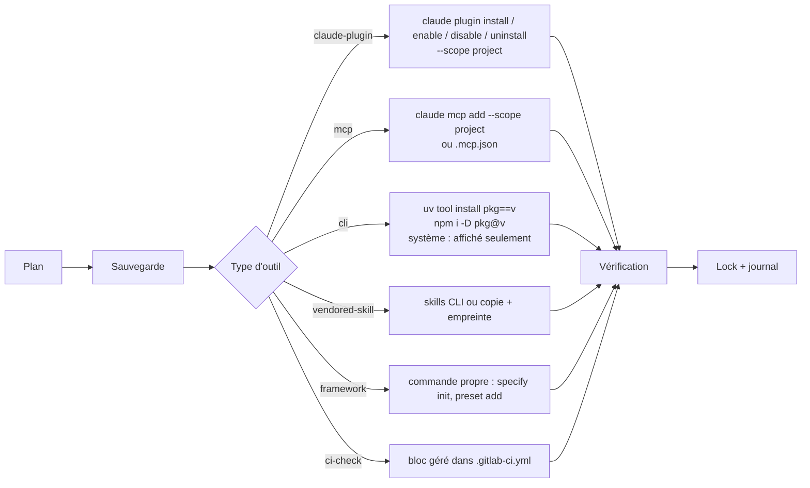

# 05 — Gestion des outils (ex-Plugin Manager)

> **[RECO]** sauf mention **[FAIT]**. Les commandes natives citées sont vérifiées dans la doc Claude Code du 2026-11-11.

## 1. Principe : PEO calcule, les installeurs installent

PEO ne télécharge rien, ne résout aucune contrainte semver, ne gère aucun cache. Pour chaque **type** d'outil, il délègue à l'installeur natif et se contente de :

1. calculer le plan (quoi, dans quel ordre, avec quel risque) ;
2. sauvegarder ce qu'il va toucher ;
3. appeler l'installeur ;
4. vérifier le résultat ;
5. enregistrer la version, l'empreinte et les **artefacts possédés** dans le lock ;
6. journaliser.



## 2. Types d'outils et adaptateurs

| Type | Exemples | Installeur délégué | Portée | Activation sans réinstallation | Possède (pour la désinstallation) |
|---|---|---|---|---|---|
| `claude-plugin` | EGM, Matt Pocock, LSP natifs, Semgrep | `claude plugin …` [FAIT] | projet (défaut), utilisateur | **Oui** : `enable` / `disable` [FAIT] | Entrées `enabledPlugins` et `extraKnownMarketplaces` |
| `mcp` | Serena, REA, Playwright MCP | `claude mcp add` ou écriture de `.mcp.json` | projet | Oui : retrait de l'entrée, configuration conservée dans le lock | Entrée `.mcp.json` |
| `cli` | `specify-cli`, `graphifyy`, `serena-agent`, `semgrep`, `ast-grep` | `uv tool`, `npm -D`, `cargo` ; gestionnaires système **affichés, jamais exécutés** | poste ou projet | Non pertinent | Rien dans le dépôt (sauf `devDependencies`) |
| `vendored-skill` | `ui-ux-pro-max`, `ce-compound` | skills CLI [À VÉRIFIER] ou copie | projet | Oui : `disable-model-invocation` ou déplacement hors du dossier | Dossier `.claude/skills/<nom>/` + empreinte |
| `framework` | Spec Kit (init, preset, extension) | sa propre CLI | projet | Selon le framework | Liste des fichiers déclarée par le framework (manifestes Spec Kit dans `.specify/integrations/`) [FAIT] |
| `ci-check` | Semgrep, contrôle d'architecture, `peo status --ci` | écriture d'un bloc entre marqueurs | projet | Oui : bloc commenté | Bloc `# peo:begin <id>` … `# peo:end <id>` |
| `rule` | Règles par stack `.claude/rules/*.md` | copie depuis le catalogue | projet | Oui | Fichier + empreinte |

Chaque adaptateur implémente la même interface :

```text
detect(entry)            → installé ? version ? activé ? portée ?
plan(entry, desired)     → actions avec classe de risque
apply(action)            → résultat
verify(entry)            → santé (commande de vérification de la fiche)
owned(entry)             → artefacts possédés, avec empreinte
remove(entry, keep_cfg)  → retrait limité aux artefacts possédés et non modifiés
```

## 3. Opérations

### 3.1 Inventaire — `peo tools list`, `peo status`

| Information | Source |
|---|---|
| Disponible | Catalogue |
| Installé, version, portée, activé | Inventory (R2) : réglages des portées managed, local, project et user, `.mcp.json`, `claude plugin list`. CLI et paquets : `Adapter.detect` (R5). Dossiers de skills : hors R2 |
| Possédé par PEO ou installé à la main | Présence dans `peo.lock.json` |
| Dépendances manquantes | `requires` des fiches, comparé à l'inventaire |
| Incompatibilités | `conflicts` des fiches, exclusivité des socles, collisions d'événements de hook |
| Redondances | Deux outils actifs couvrant la même capacité « exclusive » |
| Hooks actifs | Lecture des `hooks.json` des plugins activés et des settings, groupés par événement et par propriétaire |
| Coût de contexte | Somme des estimations des fiches des outils actifs |
| Contrôles d'exposition (ajout du 2026-11-12) | Règles `permissions.deny`, état et options du sandbox, `onFailure` des hooks, forme des valeurs dans les configs d'agent. Document 17, section 6.2 |

Un outil présent mais **inconnu du catalogue** est signalé comme « non évalué », jamais supprimé.

### 3.2 Ajout — `peo tools add <id>`

1. Fiche trouvée et non expirée. Sinon refus, avec proposition de fiche locale (section 7).
2. Le Selector recalcule l'état désiré **avec** l'outil : conflits, exclusivités, capacités désormais redondantes.
3. Plan affiché : actions, hooks ajoutés par événement, accès réseau, coût de contexte avant/après, outils devenus redondants.
4. Accord explicite.
5. Application, vérification, lock, journal, régénération de la doc.

### 3.3 Retrait — `peo tools remove <id>`

1. Dépendants : quels outils de l'état désiré `requires` cet outil ; quelles **étapes de recette** l'utilisent (ex. retirer EGM supprime la porte G2 « relecture indépendante »).
2. Plan : artefacts possédés à retirer. Un artefact **modifié** depuis l'installation (empreinte différente) est **conservé** et signalé.
3. Option `--keep-config` (défaut) : la configuration propre à l'outil reste dans `peo.toml` sous `[tools.<id>]` avec `enabled = false`.
4. Accord, sauvegarde, retrait, lock, journal.

### 3.4 Activation et désactivation — `peo tools enable|disable <id>`

- Aucune désinstallation. `claude plugin disable`, retrait de l'entrée MCP, ou désactivation du bloc CI.
- Recettes impactées affichées (ex. désactiver Semgrep retire l'étape de sécurité de `flow release`).
- Entrée conservée dans le lock avec `enabled: false`.

### 3.5 Mise à jour — `peo tools update [<id>|--all] [--plan]`

1. **Détecter** : versions disponibles, selon l'installeur (tags git de la marketplace, PyPI, npm).
2. **Comparer** : installée, verrouillée, **testée** dans la fiche du catalogue (`versions.tested`), disponible.
3. **Changements** : lien vers le changelog de la source. **Différence de surface** recalculée : hooks ajoutés ou retirés, nouveaux serveurs MCP, nouvelles écritures de fichiers. C'est l'information que personne ne fournit aujourd'hui.
4. **Compatibilité** : la nouvelle version sort-elle de `versions.max` ? Viole-t-elle un `conflicts` ?
5. Plan + accord, sauvegarde, mise à jour, **vérification** (`verify` de la fiche), lock, journal.
6. Échec de vérification → rollback (section 4).

Il faut distinguer **trois choses qui se mettent à jour**, avec des mécanismes différents :

| Quoi | Exemple | Mécanisme |
|---|---|---|
| L'outil | EGM 0.1.1 → 0.2.0 | `peo tools update` |
| Ses dépendances | Une dépendance de plugin résolue par Claude Code | Installeur natif, PEO observe seulement |
| La configuration du projet générée pour cet outil | Preset Spec Kit, bloc CI, règle | Régénérée par PEO depuis le catalogue. **Les modifications locales sont détectées par empreinte et jamais écrasées** sans accord |

### 3.6 Politiques de mise à jour

| Politique | Comportement | MVP |
|---|---|---|
| `manual` | `peo status` signale les mises à jour. Rien n'est préparé | **Oui (défaut)** |
| `prepare` | `peo tools update --plan` calcule le plan, la différence de surface et la compatibilité, et attend | **Oui** |
| `auto` | Applique en CI les mises à jour autorisées par la politique (ex. `patch` d'un outil épinglé, sans changement de surface, vérification au vert), sur une branche, avec merge request | **Non**. Après au moins trois mois d'usage de `prepare` |

Garde-fous permanents, même en `auto` : jamais d'outil nouveau, jamais de changement de surface (hook, MCP, réseau) sans accord, jamais sur la branche principale directement.

## 4. Sauvegarde, rollback, historique

| Mécanisme | Portée | Limite honnête |
|---|---|---|
| **Sauvegarde** | Fichiers du dépôt que PEO va modifier, dans `.peo/backups/<horodatage>/` (hors git) | Ne couvre pas le cache des plugins ni les outils installés sur le poste |
| **Git** | Toute la configuration est versionnée : le vrai rollback de la configuration est `git revert` | Suppose que l'utilisateur commite après `apply` (PEO ne commite pas) |
| **Rollback d'outil** | Réinstallation de la version du lock précédent | Possible seulement si l'installeur sait installer une version précise (plugins avec tags `<plugin>--v<version>`, PyPI, npm). **Impossible** pour une marketplace sans tags : PEO le dit dans le plan |
| **Journal** | `history.ndjson` : chaque action, son résultat, les empreintes avant et après | Ne restaure rien par lui-même |

Rollback automatique : seulement **dans la même commande**, si la vérification d'après installation échoue. Au-delà, c'est une action explicite : `peo tools rollback <id>` (ultérieur).

## 5. Résolution des conflits

Trois natures de conflit, trois traitements :

| Conflit | Exemple | Traitement |
|---|---|---|
| **Exclusivité de socle** | Superpowers + Spec Kit/EGM/Matt | Le Selector n'en garde qu'un. Si les deux sont déjà actifs : `!` dans le plan, choix demandé, **rien n'est désinstallé d'office** |
| **Capacité exclusive en double** | Deux outils `ui.design` | Le Selector garde celui de meilleur score, l'autre apparaît dans les « alternatives écartées » |
| **Collision technique** | Deux plugins en `SessionStart` qui injectent un processus, deux rédacteurs de `CLAUDE.md`, un outil qui contourne la porte | Règles déclarées dans les fiches (`hooks.events`, `writes`, `write_tools`). Refus ou adaptation (ex. matcher étendu) |
| **Réécriture des entrées ou sorties d'outils** (ajout du 2026-11-12) | Deux masqueurs actifs : doubles placeholders, `updatedInput` concurrents [HYPOTHÈSE : comportement de deux `updatedInput` non vérifié, spike S5] | Capacité exclusive `privacy.masking` ; champ `data_path = "rewrites-io"` |
| **Harnais d'exécution** (ajout du 2026-11-12) | Deux orchestrateurs qui fixent l'agent par défaut ou posent leurs hooks de fusion | Capacité exclusive `orchestration.harness`, ajoutée avec la première fiche (H25) |

## 6. Validation

| Moment | Validation |
|---|---|
| Ajout d'une fiche au catalogue | Schéma, source atteignable, version testée existante, hooks et MCP inventoriés automatiquement et comparés à la fiche, relecture humaine (merge request sur le dépôt du catalogue) |
| Avant installation | Plan + accord, classe de risque de chaque action |
| Après installation | `verify` de la fiche (ex. `specify --version`, `claude plugin list`, présence du skill) |
| En continu | `peo status --ci` en CI : lock ↔ réel, hooks ↔ fiches, dérive des fichiers générés |
| Expiration | Chaque fiche a `evaluated` et `review_by`. Passée la date, l'outil reste utilisable mais signalé « évaluation périmée » |

## 7. Catalogue : stratégie de maintenance

| Option | Avantages | Inconvénients |
|---|---|---|
| Dépôt centralisé curé | Qualité, relecture, versions testées | Charge de maintenance sur l'équipe PEO |
| Sources externes (marketplaces, skills.sh, APM) | Exhaustif, à jour | Non évalué : contraire à la raison d'être de PEO |
| **Hybride** [RECO] | | |

Hybride concrètement :

1. **Catalogue public curé** : dépôt Git de PEO, fiches TOML, versionné par tags. Petit (cible MVP : 15 à 20 fiches).
2. **Catalogue d'organisation** (ultérieur) : dépôt privé qui **surcharge ou ajoute** des fiches.
3. **Fiches locales au projet** : section `[catalog.local]` de `peo.toml`, pour un outil interne. Marquées « non évaluées par PEO ».
4. **Sources externes en lecture seule** : `peo catalog suggest` peut lister des candidats depuis les marketplaces connues, **jamais** les installer sans fiche.

Automatisation du dépôt de catalogue (CI hebdomadaire) : pour chaque fiche, vérifier que la source existe, détecter les nouvelles versions, **recalculer la surface** (hooks, MCP, `bin/`) de la dernière version et ouvrir une issue si elle diffère de la fiche. C'est ce qui rend le catalogue tenable à plusieurs.

## 8. Révision du 2026-11-12 : outils de sécurité et autres agents

### 8.1 Nouveaux champs de fiche

| Champ | Valeurs | Usage |
|---|---|---|
| `data_path` | `rewrites-io` (réécrit entrées ou sorties d'outils), `reads-sensitive` (lit des données du projet hors du dépôt de code : base, navigateur, e-mails), `none` | Exclusivité, affichage du plan, contrôles d'exposition |
| `fail_mode` | `open`, `closed` | Afficher ce qui se passe quand l'outil est absent ou en panne. Un outil `closed` peut bloquer le travail ; un outil `open` laisse passer |

Les fiches d'outils `data_path = "rewrites-io"` ont un `review_by` court (30 jours, point ouvert O3 du document 17) : elles sont sur le chemin de toutes les données.

### 8.2 Premières fiches de sécurité

| Fiche | Capacité | Condition | État |
|---|---|---|---|
| `ci-check:gitleaks` | `secrets.scan.ci` | Toujours proposée (exigence souple) | Premier lot |
| `ci-check:semgrep` | `review.security.sast` | Inchangée (spec 13) | Premier lot |
| `claude-plugin:cloakroom` | `privacy.masking` | Signal `secret_files` ou `data_stores` ; jamais par défaut (H22) | **Après le spike S5** |
| Réglages natifs (`permissions.deny`, sandbox) | `exposure.native` | Fournis par PEO lui-même via le Composer | Premier lot |

### 8.3 Autres agents (H23)

| Agent | Lecture (Inventory) | Écriture (adaptateur) |
|---|---|---|
| Claude Code | Jalon A′ | MVP |
| Codex | Dès qu'un projet pilote l'utilise (E7) | P8 (via rulesync ou APM, inchangé) |
| Gemini CLI | Plus tard : son format de session change d'une version à l'autre | Plus tard |

La lecture seule d'abord : un audit multi-agents est utile sans qu'aucun adaptateur d'écriture n'existe.
