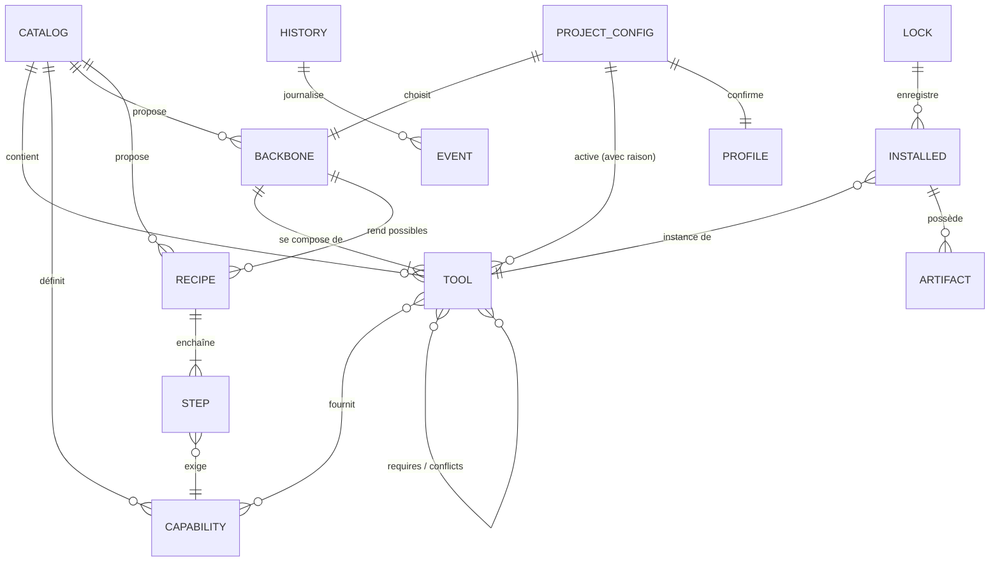

# 06 — Modèle de données

> **[RECO]** dans tout le document. Les exemples sont illustratifs : les valeurs de version et d'empreinte non citées dans le document 03 sont fictives.
>
> **Mise à jour du 2026-11-11** : les schémas validés de [spec/schemas/](spec/schemas/README.md) font foi. Ils complètent ce document sur six points issus du pilote : `components[]` et `metrics` dans le profil (E1, E5) ; `[components.<id>]`, `[conventions]` et `before_code` **par recette** dans `peo.toml` ; `[[prerequisites]]`, `[detect]`, `[conventions]` et `install.manager` dans la fiche (E3, E5, E6) ; la capacité `debug.diagnosis` et les capacités de navigation par langage (`nav.lsp.<langage>`) ; le langage `when` formalisé (spec 13, section 3) ; la sortie du Selector et le plan.

## 1. Vue d'ensemble



| Entité | Où | Qui écrit |
|---|---|---|
| Capability, Tool, Backbone, Recipe | Catalogue (dépôt de PEO) | Mainteneurs du catalogue |
| Profile | `.peo/profile.json` | Discovery |
| Project config | `.peo/peo.toml` | `/peo:init`, puis l'humain |
| Lock, Installed, Artifact | `.peo/peo.lock.json` | Installers |
| History, Event | `.peo/history.ndjson` | Journal |

## 2. Capacités : le vocabulaire commun

Toute la sélection repose sur un **vocabulaire fermé de capacités**. Sans lui, impossible de détecter des redondances autrement qu'au cas par cas.

```toml
# catalog/capabilities.toml (extrait)
[capabilities]
"spec.authoring" = { exclusive = true, description = "Rédiger la spécification d'une fonctionnalité" }
"spec.review.independent" = { exclusive = false, description = "Relecture d'un document par un agent sans contexte" }
"plan.tasks" = { exclusive = true, description = "Découper en tâches traçables" }
"clarify.interview" = { exclusive = true, description = "Interroger l'humain pour lever les ambiguïtés" }
"tdd.discipline" = { exclusive = true, description = "Consignes de TDD suivies par l'agent" }
"tdd.enforcement" = { exclusive = true, description = "Blocage effectif du code sans test" }
"review.code" = { exclusive = true, description = "Revue de code structurée" }
"review.security.sast" = { exclusive = false, description = "Analyse statique de sécurité" }
"nav.symbols" = { exclusive = false, description = "Navigation et édition par symbole" }
"nav.graph" = { exclusive = false, description = "Carte macro du code" }
"search.structural" = { exclusive = false, description = "Recherche par motifs d'AST" }
"ui.design" = { exclusive = true, description = "Conception d'interface" }
"browser.e2e" = { exclusive = true, description = "Pilotage d'un navigateur" }
"re.artifact" = { exclusive = false, description = "Analyse d'un artefact sans code source" }
"knowledge.lessons" = { exclusive = true, description = "Capitalisation des leçons" }
"docs.libraries" = { exclusive = false, description = "Documentation de bibliothèques à jour" }
"drift.docs" = { exclusive = false, description = "Dérive documentation ↔ code" }
"process.gates" = { exclusive = true, description = "Portes de processus appliquées" }
```

`exclusive = true` : deux outils actifs fournissant cette capacité sont une **redondance** à résoudre.

## 3. Fiche d'outil

```toml
# catalog/tools/serena.toml
id          = "serena"
name        = "Serena"
kind        = "mcp"                      # claude-plugin | mcp | cli | vendored-skill | framework | ci-check | rule
description = "Outils d'IDE par symbole via serveurs de langage"
status      = "conditional"              # core | conditional | backbone-alt | rejected | watch
license     = "GPL-3.0-or-later"         # application ; SolidLSP en MIT
source      = { repo = "https://github.com/oraios/serena", commit = "6e5c377", checked = "2026-11-11" }

[versions]
tested = "2.1.1.dev0"                    # ce que PEO a évalué
min    = "2.0"
max    = "2.*"
pin    = true                            # PEO installe la version testée, jamais @latest

[capabilities]
provides = ["nav.symbols"]

[relations]
requires  = ["cli:uv"]
conflicts = []                           # conflits durs
overlaps  = ["claude-plugin:typescript-lsp", "claude-plugin:php-lsp"]   # recouvrements doux, informatifs
supersedes = []

[selection]                              # quand le proposer
when.any = ["profile.loc > 50000", "answers.refactoring_planned == true", "profile.repo.monorepo == true"]
when.not = ["profile.kind == 'new'"]
score    = { value = 3, cost_weight = 1 }

[surface]                                # ce que l'outil ajoute à l'environnement
hooks       = []                         # événements de hook occupés
mcp_tools   = 20                         # nombre approximatif de schémas d'outils
write_tools = ["mcp__serena__replace_symbol_body", "mcp__serena__insert_after_symbol",
               "mcp__serena__insert_before_symbol", "mcp__serena__rename_symbol",
               "mcp__serena__safe_delete_symbol", "mcp__serena__replace_content",
               "mcp__serena__replace_in_files"]                      # → ajoutés au matcher de la porte
path_arg    = "relative_path"
writes      = [".serena/"]               # fichiers ou dossiers que l'outil écrit dans le dépôt
network     = "none"                     # none | install-only | runtime
runs_target = false

[cost]
context_static_tokens = 3000             # estimation, ordre de grandeur
runtime     = "LSP par langage, mémoire RAM notable sur gros dépôts"
evidence    = "estimate"                 # measured | vendor-claim | estimate

[install]
cli    = "uv tool install -p 3.13 serena-agent=={version}"
config = { mcp = { command = "serena", args = ["start-mcp-server", "--context", "claude-code", "--mode", "no-memories", "--project", "{project_dir}"] } }
verify = "serena --version"

[uninstall]
cli    = "uv tool uninstall serena-agent"
config = "remove-mcp-entry"
keep   = [".serena/"]                    # jamais supprimé automatiquement

[notes]
risks   = ["Remplace Edit par ses outils : porte à étendre", "Ne pas installer par la marketplace (README Serena)"]
evaluated = "2026-11-11"
review_by = "2027-02-11"
```

Champs **obligatoires** : `id`, `kind`, `status`, `license`, `source`, `versions.tested`, `capabilities.provides`, `surface` (même vide), `install`, `uninstall`, `notes.evaluated`, `notes.review_by`.

## 4. Socle méthodologique

```toml
# catalog/backbones/speckit-egm-mattpocock.toml
id          = "speckit-egm-mattpocock"
name        = "Spec Kit + EGM + Matt Pocock"
status      = "default"
tools       = ["framework:spec-kit", "claude-plugin:egm", "claude-plugin:mattpocock-skills"]
provides    = ["spec.authoring", "spec.review.independent", "plan.tasks", "clarify.interview",
               "tdd.discipline", "review.code", "drift.docs"]
excluded_skills = ["egm:egm-draft", "mattpocock-skills:to-spec", "mattpocock-skills:to-tickets",
                   "mattpocock-skills:implement", "mattpocock-skills:implement-spec"]   # doublons internes
recipes     = ["feature", "bugfix", "refactor", "review", "release"]
min_claude_code = "2.1.271"             # isolation des Goldfish (omitClaudeMd)

[knowledge]
specs      = "specs/"
adr        = "docs/adr/"
glossary   = "GLOSSARY.md"
principles = ".specify/memory/constitution.md"
standards  = "CODING_STANDARDS.md"
```

Un projet a **exactement un** socle actif. Les socles alternatifs (Superpowers, BMAD, Compound Engineering, ECC) ont la même structure avec `status = "backbone-alt"`.

## 5. Recette de processus

```toml
# catalog/recipes/feature.toml
id = "feature"
tracks = ["S", "M", "L"]

[[steps]]
id = "clarify"
needs = "clarify.interview"
tracks = ["M","L"]
[[steps]]
id = "specify"
needs = "spec.authoring"
tracks = ["M","L"]
gate_after = "G1"
[[steps]]
id = "plan"
needs = "plan.tasks"
tracks = ["M","L"]
[[steps]]
id = "review-plan"
needs = "spec.review.independent"
tracks = ["L"]
optional_tracks = ["M"]
gate_after = "G3"
[[steps]]
id = "tasks"
needs = "plan.tasks"
tracks = ["M","L"]
gate_after = "G4"
[[steps]]
id = "implement"
needs = "tdd.discipline"
tracks = ["S","M","L"]
code_allowed = true
[[steps]]
id = "verify"
needs = "project.verify_cmd"
tracks = ["S","M","L"]
gate_after = "G5"
[[steps]]
id = "security"
needs = "review.security.sast"
tracks = ["L"]
if_available = true
[[steps]]
id = "review"
needs = "review.code"
tracks = ["S","M","L"]
gate_after = "G7"
```

Le **socle** dit quelle commande réalise chaque capacité (ex. `spec.authoring` → `/speckit-specify`). Une étape dont la capacité n'est pas disponible est **sautée** (`if_available`) ou **bloquante** (par défaut). C'est ce qui rend les recettes indépendantes des outils.

## 6. `.peo/peo.toml` (configuration du projet)

```toml
schema       = 1
peo_version  = "0.1.0"

[project]
name     = "portail-client"
mission  = "Portail self-service B2B : contrats, tickets ServiceNow, SSO Keycloak."
kind     = "existing"                    # new | existing | modernize | rebuild
category = "internal-app"                # saas | internal-app | api | library | cli | other
team     = "team"
languages = { artifacts = "fr", code = "en" }

[backbone]
id = "speckit-egm-mattpocock"

[tools]                                  # outils activés en plus du socle, avec la raison
"claude-plugin:php-lsp"           = { enabled = true, reason = "stack php-laravel (fait)" }
"claude-plugin:security-guidance" = { enabled = true, reason = "SSO et données personnelles (réponse)" }
"mcp:serena"                      = { enabled = true, reason = "82 000 lignes (fait)" }
"cli:semgrep"                     = { enabled = false, reason = "désactivé le 2026-12-02 : faux positifs", keep_config = true }

[commands]
verify = "make verify"
test   = "php artisan test"
arch   = "vendor/bin/deptrac analyse"

[paths]
code = ["app/**", "resources/js/**", "database/**", "routes/**", "tests/**"]

[knowledge]                              # surcharges des emplacements du socle
adr = "docs/decisions/"                  # chemin réel de ce dépôt

[gates]
mode = "ask"                             # off | ask | deny
before_code  = ["G1", "G3", "G4"]
before_merge = ["G5", "G7"]

[tracks]
default = "M"

[policy]
autonomy = "guided"                      # guided | semi | autonomous
updates  = "prepare"                     # manual | prepare | auto
require_consent = ["install", "remove", "modify-settings", "network"]

[catalog]
source = "https://gitlab.example.com/peo/catalog.git"
ref    = "v2026.11"

[answers]                                # réponses du questionnaire, pour la reconfiguration
sensitive = true
refactoring_planned = true
```

## 7. `.peo/profile.json` (sortie de Discovery)

Chaque information porte sa **provenance** et un **niveau de confiance**. C'est ce qui permet la règle « ne jamais demander ce qui se déduit, présenter l'incertain comme hypothèse ».

```json
{
  "schema": 1,
  "generated": "2026-11-11T14:02:11+01:00",
  "repo": { "commits": 1843, "tracked_files": 640, "loc": { "php": 61200, "vue": 14800, "ts": 6100 }, "monorepo": false },
  "kind": { "value": "existing", "confidence": "fact", "evidence": "1843 commits" },
  "stacks": [
    { "id": "php-laravel", "confidence": "fact", "evidence": "composer.json: laravel/framework ^11.0" },
    { "id": "vue", "confidence": "fact", "evidence": "package.json: vue ^3.4" },
    { "id": "postgres", "confidence": "likely", "evidence": "config/database.php: pgsql par défaut ; pas de migration spécifique" }
  ],
  "commands": { "verify": { "value": "make verify", "confidence": "likely", "evidence": "Makefile: cible verify" } },
  "quality": ["pint", "phpstan", "eslint"],
  "ci": { "kind": "gitlab", "file": ".gitlab-ci.yml", "jobs": ["test", "lint", "build"] },
  "docs": { "readme": true, "adr": "docs/decisions/", "agents_md": false, "claude_md": true },
  "ai_tools": { "plugins": ["context7@claude-plugins-official"], "conflicting": [], "unknown": [] },
  "signals": { "auth": { "value": true, "evidence": "composer.json: laravel/socialite, keycloak" } },
  "gaps": ["Aucun contrôle d'architecture", "Pas de AGENTS.md", "Couverture de tests inconnue (aucun rapport)"],
  "questions_needed": ["mission", "category", "deployment_targets"]
}
```

Niveaux de confiance : `fact` (lu dans un manifeste), `likely` (déduit d'un indice), `unknown`. Seuls `likely` et `unknown` donnent lieu à une question.

## 8. `.peo/peo.lock.json`

```json
{
  "schema": 1,
  "generated": "2026-11-11T14:05:40+01:00",
  "peo": "0.1.0",
  "catalog": { "source": "https://gitlab.example.com/peo/catalog.git", "ref": "v2026.11", "commit": "<sha>" },
  "claude_code": "<version détectée>",
  "tools": {
    "claude-plugin:egm": {
      "version": "0.1.1", "scope": "project", "enabled": true,
      "owns": [ { "file": ".claude/settings.json", "keys": ["enabledPlugins.egm@egm", "extraKnownMarketplaces.egm"] } ]
    },
    "vendored-skill:ui-ux-pro-max": {
      "version": "2.15.0", "upstream_commit": "6ae86f6", "enabled": true,
      "owns": [ { "dir": ".claude/skills/ui-ux-pro-max/", "sha256": "<empreinte du contenu>" } ]
    },
    "mcp:serena": {
      "version": "<version installée>", "enabled": true,
      "owns": [ { "file": ".mcp.json", "keys": ["mcpServers.serena"] } ]
    }
  }
}
```

`owns` est la clé de la désinstallation propre : PEO ne retire que ce qu'il possède, et seulement si l'empreinte n'a pas changé.

## 9. `.peo/history.ndjson`

```json
{"ts":"2026-11-11T14:05:31+01:00","actor":"peo-cli","cmd":"apply","plan":"a41f…","action":"install","tool":"claude-plugin:egm","version":"0.1.1","result":"ok"}
{"ts":"2026-11-11T14:05:38+01:00","actor":"peo-cli","cmd":"apply","plan":"a41f…","action":"write","file":"AGENTS.md","before":"sha256:…","after":"sha256:…","backup":".peo/backups/2026-11-11T14-05/AGENTS.md","result":"ok"}
{"ts":"2026-12-02T09:12:00+01:00","actor":"dev","cmd":"tools disable","tool":"cli:semgrep","reason":"faux positifs","result":"ok"}
```

## 10. Algorithme de sélection

Le problème est un **recouvrement d'ensemble pondéré sous contraintes** : couvrir les capacités requises par le projet avec le moins d'outils et le moindre coût, sans conflit.

- **Entrées** : capacités requises (dérivées du socle, du profil et des réponses), outils candidats (fiches dont `when` est vrai), coûts (`cost.context_static_tokens`, nombre de hooks), contraintes (`conflicts`, exclusivité des capacités et des socles, `requires`).
- **Taille réelle** : une vingtaine de candidats au plus après filtrage par `when`. Le problème est NP-difficile en général, mais à cette taille une **recherche exhaustive avec élagage** est exacte et instantanée. Pas besoin de solveur.
- **Sortie déterministe** : à égalité, ordre alphabétique de l'identifiant. Mêmes entrées, même résultat.
- **Justification** : pour chaque outil retenu, la capacité qu'il couvre et la règle `when` déclenchée ; pour chaque candidat écarté, la raison (conflit, redondance, coût, condition fausse).

```text
requis    = capacités(socle) ∪ capacités(profil, réponses)
candidats = { t ∈ catalogue | t.when(profil, réponses) ∧ t.status ∉ {rejected, watch} }
chercher S ⊆ candidats minimisant  Σ coût(t)  puis  |S|
   sous    ∪ t.provides ⊇ requis
           ∀ a,b ∈ S : a ∉ b.conflicts
           ∀ capacité exclusive c : |{t ∈ S | c ∈ t.provides}| ≤ 1
           ∀ t ∈ S : t.requires ⊆ S ∪ installé
```

Les capacités **impossibles à couvrir** sont signalées (« aucun outil du catalogue ne fournit `re.artifact` pour ce projet »), jamais comblées par un outil non évalué.
