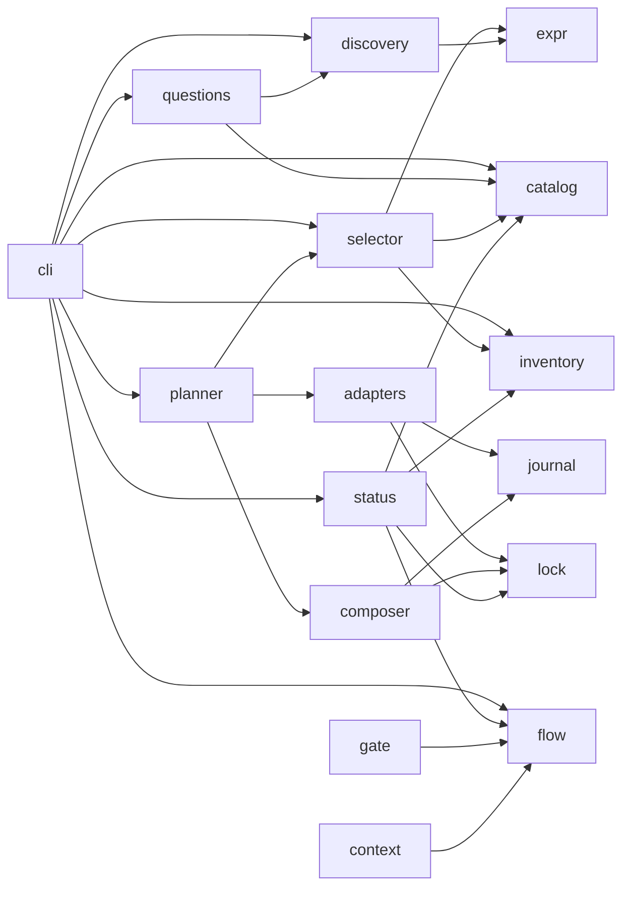

# 10 — Spécification du MVP : vue d'ensemble

> Statut : **proposition à valider**. Rien n'est construit. Cette spécification découle des décisions H1 à H12 (document 08, section 6 bis) et des écarts E1 à E6 révélés par le pilote ÉPURE (document 09).
>
> Légende reprise du dossier : **[FAIT]** vérifié (source et date), **[HYPOTHÈSE]**, **[RECO]**, **[DÉCISION]** (arbitrage qui t'appartient), **[SPIKE]** point à vérifier par un essai court au début de la phase concernée.

## 1. Objet et périmètre

La spécification décrit **ce que le MVP fait, avec quelles entrées et quelles sorties**, à un niveau qui permet d'écrire les tests avant le code. Elle couvre les fonctionnalités F1 à F13 du document 07.

| Document | Contenu | Fonctionnalités |
|---|---|---|
| [11-cli-and-commands.md](11-cli-and-commands.md) | CLI `peo`, sorties JSON, codes de sortie, skills du plugin, hooks | toutes |
| [12-discovery.md](12-discovery.md) | Détecteurs, composants, environnement d'exécution, conventions, dérive documentaire, confiance | F1 (E1, E2, E3, E5) |
| [13-catalog-and-selection.md](13-catalog-and-selection.md) | Catalogue, vocabulaire de capacités, langage `when`, banque de questions, Selector | F2, F4, F5 (E5, E6) |
| [14-planner-installers.md](14-planner-installers.md) | Modèle d'action, risques, adaptateurs par type, fusion des fichiers, migration de `CLAUDE.md`, lock, journal | F3, F6, F7, F8, F9, F12, F13 (E3, E4, E5, E6) |
| [15-flow-and-gates.md](15-flow-and-gates.md) | Recettes `feature` et `bugfix`, portes, `peo gate`, `peo context`, `peo status` | F10, F11 |
| [16-test-plan.md](16-test-plan.md) | Fixtures, fichiers attendus, tests d'acceptation par fonctionnalité, pilote ÉPURE | toutes |
| [schemas/](schemas/) | Schémas JSON (2020-12) et exemples validés | F1, F2, F5, F6, F8 |

Ce que la spécification **ne couvre pas** : tout ce qui figure dans « Hors MVP » (document 07, section 3), et l'implémentation interne au-delà des contrats.

## 2. Glossaire

| Terme | Définition |
|---|---|
| **Composant** | Partie d'un dépôt avec son propre manifeste, ses stacks, ses commandes et son environnement d'exécution. Un dépôt a au moins un composant (`.`). ÉPURE en a deux : `.` (Nuxt) et `backend` (Laravel) (E1) |
| **Environnement d'exécution** (`runtime`) | Où tournent les commandes d'un composant : `host` ou `docker:<service>` (E5) |
| **Capacité** | Identifiant du vocabulaire fermé (`spec.authoring`, `nav.lsp.php`…). Une capacité `exclusive` ne peut être fournie que par un seul outil actif |
| **Exigence** | Capacité requise pour le projet. **Dure** : non couverte = sélection en échec signalé. **Souple** : non couverte = information |
| **Fiche** | Description TOML d'un outil dans le catalogue. Référence d'outil : `<kind>:<id>` (ex. `claude-plugin:egm`) |
| **Socle** (`backbone`) | Ensemble d'outils qui fournit le cycle méthodologique complet. Exactement un actif par projet |
| **Recette** | Suite d'étapes exprimées en capacités (`feature`, `bugfix`) |
| **Piste** (`track`) | Taille d'un travail : S, M, L. Elle choisit les étapes d'une recette |
| **Porte** | Condition vérifiable avant une étape (G1 spec approuvée, G4 tâches approuvées…) |
| **Plan** | Liste ordonnée d'actions calculée sans rien écrire. Identifié par une empreinte |
| **Action** | Unité du plan : ajout, modification, retrait, conservation ou étape manuelle, avec une classe de risque |
| **Possession** (`owns`) | Ce que PEO a écrit et peut donc retirer : clés JSON, blocs gérés, fichiers avec empreinte |
| **Bloc géré** | Région d'un fichier délimitée par des marqueurs `peo:begin` / `peo:end`. PEO ne touche rien en dehors |
| **Confiance** | `fact` (lu dans un fichier faisant autorité), `likely` (déduit d'un indice), `unknown` |
| **Réutilisation** | Capacité déjà couverte par un outil présent dans le projet (ex. Playwright en dépendance de dev) (E6) |

## 3. Architecture du code de PEO

Un seul dépôt `peo`, sous licence Apache-2.0 (H8). Code, messages, clés et fiches en anglais (H10).

```text
peo/
├── pyproject.toml                  # paquet « peo », point d'entrée console « peo »
├── src/peo/
│   ├── cli.py                      # analyse des arguments, enveloppe JSON, codes de sortie
│   ├── model.py                    # dataclasses : Profile, ToolEntry, Selection, Plan, Action, Lock, Event
│   ├── validate.py                 # validateur du sous-ensemble JSON Schema utilisé (stdlib)
│   ├── expr.py                     # langage `when` : analyseur et évaluateur sans eval()
│   ├── discovery/                  # F1 : un module par détecteur
│   ├── catalog.py                  # F2 : chargement, résolution, validation des fiches
│   ├── inventory/                  # F3 : claude_plugins.py, mcp.py, cli_tools.py, dev_deps.py
│   ├── questions.py                # F4 : sélection des questions à poser
│   ├── selector.py                 # F5
│   ├── planner.py                  # F6 : calcul et empreinte du plan
│   ├── adapters/                   # F6/F7 : claude_plugin.py, mcp.py, cli_uv.py, cli_npm.py,
│   │                               #         framework_speckit.py, files.py, ci.py
│   ├── composer/                   # F7 : settings.py, agents_md.py, claude_md.py, rules.py, blocks.py
│   ├── lock.py, journal.py         # F8
│   ├── render.py                   # F9 : .peo/README.md
│   ├── gate.py, context.py         # F10 : hooks (imports minimaux)
│   ├── flow.py                     # F10 : état des recettes et approbations
│   ├── status.py                   # F11
│   └── schemas/*.schema.json       # copie des schémas de cette spécification
├── catalog/                        # instantané du catalogue pour les tests (le catalogue vit dans son dépôt)
├── plugin/                         # plugin Claude Code « peo »
│   ├── .claude-plugin/plugin.json
│   └── skills/{init,status,tools,flow}/SKILL.md
└── tests/
    ├── fixtures/                   # dépôts de test (document 16)
    └── golden/                     # sorties attendues
```



Règles de dépendance : aucun cycle ; `gate.py` et `context.py` n'importent que `json`, `os`, `pathlib`, `fnmatch`, `tomllib` et `flow.py`, pour tenir la contrainte de latence.

## 4. Exigences non fonctionnelles

| # | Exigence | Mesure |
|---|---|---|
| NF1 | **Python ≥ 3.11, bibliothèque standard seule à l'exécution** | Aucune dépendance déclarée dans `[project.dependencies]`. Dépendances de développement autorisées : pytest, hypothesis, jsonschema |
| NF2 | **Validation sans dépendance** : `validate.py` implémente le sous-ensemble JSON Schema employé par les schémas de PEO (`type`, `required`, `properties`, `additionalProperties`, `items`, `enum`, `const`, `pattern`, `minimum`, `minItems`, `$ref` local, `$defs`, `oneOf` limité aux discriminants `const` et aux alternatives « valeur ou `null` ») | Un test compare ses verdicts à ceux de `jsonschema` sur tous les exemples et contre-exemples |
| NF3 | `peo discover` < 5 s sur 100 000 lignes suivies par git | Fixture synthétique générée |
| NF4 | `peo gate` < 100 ms au 95e centile, `peo context` < 150 ms | Mesure sur 200 appels |
| NF5 | **Aucune exécution réseau hors adaptateurs**, et adaptateurs seulement après accord | Test : `discover`, `select`, `plan`, `status`, `gate` sous un environnement sans réseau |
| NF6 | **Aucun `shell=True`**, arguments en liste, chemins normalisés et confinés au dépôt (refus de `..` et des liens symboliques sortants) | Revue + tests de chemins hostiles |
| NF7 | **Aucune installation système** : jamais `sudo`, `apt`, `brew`, `winget`. Les installations au niveau utilisateur (`uv tool`, `npm -g` avec préfixe utilisateur, `claude plugin`) sont des actions R3 soumises à accord | Test : les adaptateurs refusent une commande qui exige des droits élevés |
| NF8 | **Déterminisme** : mêmes entrées, mêmes sorties octet pour octet (tri des clés, ordre stable, pas d'horodatage dans le plan) | Tests de propriétés |
| NF9 | **Compatibilité Claude Code ≥ 2.1.285** pour la lecture complète de `claude plugin list --json` (champ `projectEnabled`). En dessous, mode dégradé : lecture directe des fichiers de réglages, signalée par `peo status` | **[FAIT]** documentation « Plugin commands reference », consultée le 2026-11-11 |
| NF10 | Linux et macOS. Windows via WSL seulement au MVP | |
| NF11 | Chaque fichier écrit par PEO porte `schema` (entier). Une version de PEO lit la version de schéma courante et la précédente | |
| NF12 | Messages en anglais ; artefacts du projet dans la langue `project.languages.artifacts` | |
| NF13 | Contrôle des caractères Unicode invisibles ou bidirectionnels dans toute fiche et tout fichier tiers copié (U+200B–U+200F, U+202A–U+202E, U+2066–U+2069, U+FEFF hors début de fichier) | Fiche de test piégée rejetée |

**Contrat de `validate.py` (NF2, P1.1).**

- `Schema` est le seul type de schéma accepté par `validate`. `Schema.from_dict(d)` contrôle que `d` reste dans le sous-ensemble et lève `UnsupportedSchema` sinon ; `load_schema(name)` lit `src/peo/schemas/<name>.schema.json` (`importlib.resources`) et passe par `Schema.from_dict`. Il n'existe pas d'autre chemin de contrôle.
- `validate(instance, schema: Schema) -> list[ValidationError]` : fonction pure, liste vide = valide. `ValidationError` est un `NamedTuple(path, code, message)` ; `path` est un JSON Pointer (`/components/0/name`), `code` est le mot-clé violé (`type`, `required`, `enum`, `const`, `pattern`, `minimum`, `minItems`, `additionalProperties`, `oneOf`), `message` est en anglais. Seul le verdict est comparé à `jsonschema` ; ni le code ni le texte des messages ne le sont. Le `$ref` local (`#/$defs/<nom>`) se résout contre le schéma racine du `Schema` reçu.
- Toutes les erreurs sont rapportées, triées par `(path, code, message)` (NF8).
- Un mot-clé hors du sous-ensemble (`format`, `allOf`, `$ref` non local…) lève `UnsupportedSchema` **à la construction du `Schema`**, donc avant toute validation d'instance, y compris dans une branche que l'instance ne visite pas. Les annotations `$schema`, `$id`, `title` et `description` sont ignorées ; `$defs` n'est pas une annotation ignorée : ses sous-schémas sont contrôlés comme les autres.
- Le contrôle porte aussi sur les **valeurs** des mots-clés, toujours à la construction : `type` ∈ {`string`, `number`, `integer`, `boolean`, `object`, `array`, `null`} ou liste non vide de ces noms ; `pattern` est une expression régulière qui compile ; `required` est une liste de chaînes ; `properties` et `$defs` sont des objets dont les valeurs sont des schémas ; `oneOf` est une liste non vide de schémas ; `enum` est une liste ; `minimum` est un nombre ; `minItems` est un entier ≥ 0 ; `$ref` est une chaîne `#/$defs/<nom>` qui se résout, sans cycle de références. Toute violation lève `UnsupportedSchema`.
- `additionalProperties` accepte `true`, `false` ou un sous-schéma ; `type` accepte un nom ou une liste de noms.
- `oneOf` a la sémantique générale « exactement une alternative valide » ; la restriction de NF2 décrit l'emploi qu'en font les schémas, elle n'est pas contrôlée.
- Cas limites alignés sur `jsonschema` (Draft 2020-12) : `bool` n'est ni `integer` ni `number` ; `1.0` est un `integer` ; un mot-clé qui ne concerne pas le type de l'instance est ignoré ; `pattern` utilise `re.search` ; `enum` et `const` ne confondent pas `True` et `1`.

## 5. Points techniques levés le 2026-11-11

| Point | Résultat | Conséquence |
|---|---|---|
| **H19 — Lire l'état des plugins par script** | **[FAIT]** `claude plugin list --json` renvoie un tableau d'objets avec `id`, `version`, `scope`, `enabled`, `installPath` toujours présents, et `projectPath`, `projectEnabled` (≥ 2.1.285), `errors`, `notes`, `mcpServers` quand ils s'appliquent. `install`, `uninstall`, `enable`, `disable`, `update` acceptent `--json` (≥ 2.1.268) : dernière ligne de stdout = un objet `{command, outcome, message, …}`, `failureCode: "already_in_goal_state"` à traiter comme succès. `--scope` accepte `user`, `project`, `local`. Source : [Plugin commands reference](https://code.claude.com/docs/en/plugins/cli-reference) | L'Inventory (F3) et l'adaptateur `claude-plugin` reposent sur une interface documentée et non sur des fichiers internes. Filtrer par `projectPath` : la liste contient les installations de portée projet de **tous** les projets |
| **E3 — Conventions de branches de Spec Kit** | **[FAIT]** Extension git de Spec Kit (`extensions/git/README.md`, commit `40dd00f` du 2026-11-11) : `branch_numbering` (`sequential` ou `timestamp`), `branch_template` avec les jetons `{author}`, `{app}`, `{number}`, `{slug}`, et `branch_prefix` (raccourci pour `<prefix>/{number}-{slug}`). **Contrainte** : le dernier segment doit commencer par `{number}-`. L'extension peut être désactivée (`specify extension disable git`) : les dossiers `specs/` sont alors toujours créés, sans branche | Une convention `feat/<n>-<slug>` est exprimable (`branch_prefix: "feat"`). Une convention à identifiants non numériques (`feat/A1-slug`) ne l'est pas : il faut choisir (document 14, section 5.3) |
| **E5 — LSP PHP sans PHP sur le poste** | **[FAIT]** Le plugin officiel `php-lsp` lance `intelephense --stdio` et demande seulement `npm install -g intelephense` (README du plugin, marketplace `claude-plugins-official`). Intelephense est écrit en JavaScript : **PHP n'est pas requis**. Dans ÉPURE, `docker-compose.yml` monte `./backend` dans le conteneur `api` ; `backend/vendor` était **absent** sur le poste lors de l'analyse | `php-lsp` reste sélectionnable. Deux prérequis : `intelephense` sur le `PATH` (action R3) et `backend/vendor` présent pour résoudre les symboles de Laravel (étape manuelle : `docker compose exec api composer install`) |

Restent à vérifier par un essai court :

| Spike | Question | Phase | Repli si négatif |
|---|---|---|---|
| **S1** | `claude plugin install … --scope project --json` lancé depuis l'outil Bash d'une session Claude Code se comporte-t-il comme dans un terminal ? (la doc dit seulement que `-y` y est ignoré) | P3 | Le skill `/peo:init` affiche les commandes et les fait lancer par l'utilisateur, puis `peo apply --resume` vérifie |
| **S2** | Peut-on épingler la version d'un plugin par la référence git de sa marketplace dans `extraKnownMarketplaces` ? | P3 | Version non épinglée, mais **vérifiée** après installation (`version` dans `plugin list --json`) et écart signalé par `peo status` |
| **S3** | `claude mcp list` ou `claude mcp get` offrent-ils une sortie exploitable par script ? | P1 | Lecture de `.mcp.json` (portée projet) seulement ; portée utilisateur signalée « non inspectée » |
| **S4** | Noms exacts des skills Spec Kit générés par `--integration claude` (ex. `speckit-specify`) dans la version épinglée | P4 | Lecture du dossier `.claude/skills/` après `specify init` ; la table de commandes du socle est générée, pas écrite à la main |

## 6. Décisions de spécification

Ces choix affinent la conception ; chacun est réversible.

| # | Décision | Raison |
|---|---|---|
| **S-1** | `peo plan` ne produit **pas de fichier** : `peo apply --answers - --expect-plan <empreinte>` recalcule le plan et refuse s'il diffère de celui approuvé | Pas de fichier temporaire hors des 5 éléments de `.peo/` ; le plan approuvé est exactement celui appliqué |
| **S-2** | La porte est un hook écrit dans le `.claude/settings.json` **du projet** (bloc possédé), pas dans le plugin PEO | Son `matcher` dépend des outils retenus (outils d'écriture de Serena, par exemple). Un hook de plugin est statique |
| **S-3** | `CLAUDE.md` existant : **conservé par défaut** (ajout d'un import `@AGENTS.md` et d'un bloc géré). La **migration** règle par règle est une option proposée quand `CLAUDE.md` dépasse 200 lignes ou mélange des règles à portée de chemin | Ne pas modifier sans besoin un fichier que l'humain maîtrise. Révise le plan du pilote (document 09, section 5), qui migrait d'office |
| **S-4** | Cinquième type d'installeur au MVP : `ci-check` (GitLab CI et GitHub Actions seulement), par bloc géré | `peo status --ci` (F11) et Semgrep en CI (pilote) en dépendent. Le document 07 en prévoyait quatre |
| **S-5** | Les signaux de Discovery et les questions n'existent que si une fiche, une recette ou le socle les référence | Même règle que pour les questions (document 07) : rien n'est calculé ni demandé pour rien |
| **S-6** | Les capacités de navigation sont **par langage** (`nav.lsp.php`, `nav.lsp.typescript`, `nav.lsp.python`) et **souples** | Un dépôt multi-composants (E1) a besoin de plusieurs serveurs de langage ; leur absence n'empêche pas de travailler |
| **S-7** | Les approbations de portes sont des événements du journal, liées à l'empreinte de l'artefact approuvé. Modifier `spec.md` après G1 rend G1 caduque | Une approbation porte sur un contenu, pas sur un nom de fichier |
