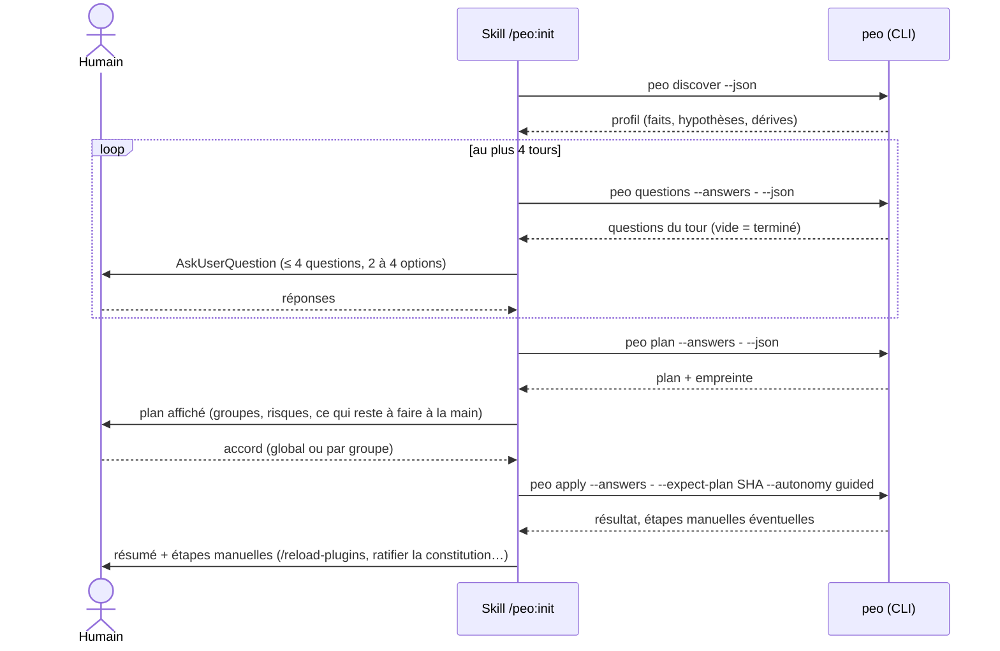

# 11 — CLI, commandes et hooks

Le cœur est le CLI `peo`. Le plugin Claude Code n'est qu'une interface : ses skills appellent le CLI, présentent les résultats et posent les questions. Tout ce que fait un skill doit être faisable sans Claude Code, en CI ou dans un terminal.

## 1. Conventions communes

### 1.1 Options globales

| Option | Effet | Défaut |
|---|---|---|
| `--project DIR` | Racine du projet | répertoire courant, remonté jusqu'à la racine git |
| `--json` | Sortie dans l'enveloppe JSON (1.2) sur stdout ; messages humains sur stderr | désactivé |
| `--catalog SOURCE` | Chemin local ou `URL@ref` du catalogue | `[catalog]` de `peo.toml`, sinon catalogue embarqué dans le paquet |
| `--no-color`, `-v`, `-q` | Affichage | |

### 1.2 Enveloppe JSON

```json
{
  "schema": 1,
  "command": "select",
  "ok": true,
  "data": { },
  "warnings": [ { "code": "W_CATALOG_EXPIRED", "message": "...", "ref": "mcp:serena" } ],
  "errors": []
}
```

`data` a un schéma par commande (dossier [schemas/](schemas/)). Les codes d'avertissement et d'erreur sont stables : un skill ou un script peut s'y fier, pas aux messages.

### 1.3 Codes de sortie

| Code | Sens |
|---|---|
| 0 | Succès |
| 1 | Erreur d'exécution (fichier illisible, adaptateur en échec) |
| 2 | Erreur d'utilisation (argument invalide) |
| 3 | `status --ci` : au moins un constat de sévérité `error` |
| 4 | Accord requis ou plan périmé : `apply` sans `--expect-plan` correspondant, ou état du dépôt changé depuis le plan |
| 5 | Prérequis non satisfait (ex. `claude` absent pour un adaptateur `claude-plugin`) |
| 6 | Sélection impossible : exigence dure non couverte, ou deux socles en conflit sans arbitrage |

Les commandes de hook (`gate`, `context`) suivent le protocole des hooks (section 4), pas ce tableau.

## 2. Commandes

### 2.1 Initialisation

| Commande | Rôle | Écrit | Sortie `data` |
|---|---|---|---|
| `peo discover [--write]` | Calcule le profil (document 12) | `.peo/profile.json` si `--write` | `profile` |
| `peo questions [--answers -]` | Questions encore nécessaires, compte tenu du profil et des réponses déjà données | rien | `{ "round": n, "questions": [...] }` |
| `peo select [--answers -]` | Sélection justifiée (document 13) | rien | `selection` |
| `peo plan [--answers -]` | Plan exact et son empreinte (document 14) | rien | `plan` |
| `peo apply --answers - --expect-plan SHA [--autonomy guided\|semi] [--only GROUP]` | Recalcule le plan, vérifie l'empreinte, applique | tout ce que le plan liste | `{ "applied": [...], "skipped": [...], "manual": [...] }` |
| `peo apply --resume` | Reprend après des étapes manuelles (spike S1) : vérifie, puis termine lock, journal et doc | lock, journal, doc | idem |

`--answers -` lit un objet JSON sur stdin : `{ "q.mission": "…", "q.gate_mode": "ask", … }`. Les réponses sont **persistées** dans `[answers]` de `peo.toml` lors de l'`apply`, pour la reconfiguration.

Séquence de `/peo:init` :



### 2.2 Exploitation

| Commande | Rôle |
|---|---|
| `peo status [--ci] [--json]` | Constats de santé (document 15, section 6). `--ci` : code 3 si un constat `error` |
| `peo tools list` | Outils du lock, de la sélection et du catalogue applicable, avec état |
| `peo tools add REF [--reason TEXT]` | Ajoute un outil : calcule un plan limité (mêmes règles de conflit), puis demande l'accord comme `apply` |
| `peo tools remove REF` | Plan de retrait limité aux possessions inchangées ; recettes impactées listées |
| `peo tools enable REF` / `disable REF [--keep-config]` | Change `enabled` dans `peo.toml` et dans la configuration de l'outil (ex. `enabledPlugins`) |
| `peo tools update --plan [REF]` | Différences de version et de **surface** (hooks, outils MCP, réseau) entre le lock et la version testée du catalogue. N'applique rien au MVP |
| `peo catalog validate [PATH]` | Valide les fiches (schéma, références, Unicode, dates). Code 1 si une fiche est invalide |
| `peo catalog show REF` | Fiche résolue |
| `peo render-doc` | Régénère `.peo/README.md` en préservant la section « Notes » |

### 2.3 Processus

| Commande | Rôle |
|---|---|
| `peo flow start RECIPE SLUG [--track S\|M\|L] [--id ID]` | Démarre un travail (document 15) : branche selon la convention retenue, dossier de spécification si la piste l'exige, événement `flow-start` |
| `peo flow state [--json]` | Travail courant, étape, portes satisfaites, prochaine commande |
| `peo flow approve GATE [--note TEXT]` | Approbation humaine d'une porte ; refusée si l'artefact requis manque |
| `peo flow verify` | Exécute la commande `verify` du ou des composants touchés ; journalise le résultat (porte G5) |
| `peo flow override GATE --reason TEXT` | Contournement explicite, journalisé et signalé par `status` |
| `peo flow done` | Clôt le travail si les portes `before_merge` sont satisfaites |

### 2.4 Hooks (appelés par Claude Code)

| Commande | Événement | Section |
|---|---|---|
| `peo gate` | `PreToolUse` | 4.2 |
| `peo context` | `SessionStart` | 4.3 |

## 3. Skills du plugin `peo`

Toutes les skills sont **déclenchées par l'utilisateur seulement** (`disable-model-invocation: true`) : aucune n'occupe le contexte en permanence. Elles appellent le CLI par l'outil Bash avec `allowed-tools` limité à `Bash(peo *)`, plus `AskUserQuestion`.

| Skill | Fait | Ne fait pas |
|---|---|---|
| `/peo:init` | Séquence de la section 2.1. Reformule le profil en une hypothèse groupée au premier tour. Affiche le plan par groupes (`+ = ~ - ?`). Demande l'accord. Lance `apply`. Liste les étapes manuelles | Décider à la place du CLI ; écrire un fichier elle-même ; installer sans `apply` |
| `/peo:status` | `peo status --json`, puis explication et action proposée pour chaque constat | Corriger sans accord |
| `/peo:tools` | Interprète la demande (« ajoute Serena ») en `peo tools …`, montre le plan, demande l'accord | Ajouter un outil absent du catalogue (elle l'explique et propose d'ouvrir une fiche) |
| `/peo:flow` | `peo flow state`, puis lance la commande du socle correspondant à l'étape suivante ou demande l'approbation de la porte | Enchaîner seule plusieurs étapes à porte |

Contrainte d'interface **[FAIT, analyse précédente]** : `AskUserQuestion` accepte au plus 4 questions par appel, chacune avec 2 à 4 options (l'utilisateur peut toujours saisir une réponse libre). `peo questions` produit donc des tours d'au plus 4 questions et des options d'au plus 4 choix, la recommandation en premier. Sans cet outil (session non interactive), la skill pose les questions en texte.

Prérequis : le CLI `peo` sur le `PATH` (`uv tool install peo==<version>`). La skill vérifie `peo --version` et compare à `min_cli` déclaré dans `plugin.json` ; en cas d'écart, elle affiche la commande d'installation et s'arrête.

## 4. Hooks

### 4.1 Où ils vivent

Décision S-2 : les deux hooks sont écrits par l'adaptateur Claude dans `.claude/settings.json` **du projet**, dans des entrées reconnues par leur commande (préfixe `peo `). Ils figurent dans `owns` du lock.

```json
{
  "permissions": {
    "ask": ["Bash(peo flow approve:*)", "Bash(peo flow override:*)"]
  },
  "hooks": {
    "PreToolUse": [
      { "matcher": "Edit|Write|MultiEdit|NotebookEdit|mcp__serena__replace_symbol_body|mcp__serena__insert_after_symbol|mcp__serena__insert_before_symbol|mcp__serena__rename_symbol|mcp__serena__safe_delete_symbol|mcp__serena__replace_content|mcp__serena__replace_in_files",
        "hooks": [ { "type": "command", "command": "peo gate", "timeout": 5 } ] }
    ],
    "SessionStart": [
      { "matcher": "startup|resume|clear|compact",
        "hooks": [ { "type": "command", "command": "peo context", "timeout": 5 } ] }
    ]
  }
}
```

Le `matcher` est **calculé** : outils d'écriture natifs + `surface.write_tools` de chaque outil actif du lock. Ajouter ou retirer Serena régénère le matcher.

### 4.2 `peo gate` (PreToolUse)

**Entrée** (stdin, JSON) **[FAIT, analyse précédente de la documentation des hooks]** : `session_id`, `transcript_path`, `cwd`, `permission_mode`, `hook_event_name`, `tool_name`, `tool_input`, `tool_use_id` ; `agent_id` et `agent_type` en plus quand l'appel vient d'un sous-agent.

**Sortie** : rien et code 0 pour laisser passer sans avis ; sinon un objet JSON sur stdout et code 0 :

```json
{ "hookSpecificOutput": {
    "hookEventName": "PreToolUse",
    "permissionDecision": "ask",
    "permissionDecisionReason": "PEO: feature 004-contact-form has no approved spec (G1). Run /peo:flow."
} }
```

`permissionDecision` vaut `ask` ou `deny` selon `[gates].mode`. L'algorithme complet est au document 15, section 4.

**Échec du hook lui-même** (exception, fichier illisible, `peo` absent du `PATH`) : comportement réglé par `[gates].on_error` :

| Valeur | Effet | Défaut quand |
|---|---|---|
| `open` | Code 0 sans sortie, avertissement sur stderr | `mode = "ask"` |
| `closed` | Code 2 avec la raison sur stderr : Claude Code bloque l'appel | `mode = "deny"` |

Pour `closed`, la commande du hook devient `peo gate || { echo "PEO gate unavailable" >&2; exit 2; }` afin de couvrir aussi l'absence de `peo` (code 127, qui serait sinon non bloquant).

### 4.3 `peo context` (SessionStart)

Sortie, seulement si `.peo/peo.toml` existe et qu'un travail est en cours :

```json
{ "hookSpecificOutput": {
    "hookEventName": "SessionStart",
    "additionalContext": "PEO: feature 004-contact-form, track M, step plan. Gates passed: G1. Next: /speckit-plan. Code edits before G4 will be asked."
} }
```

Plafond : **60 mots**. Aucun contenu de spécification n'est injecté : seulement l'état et la prochaine commande. Sans travail en cours : aucune sortie (zéro token).
